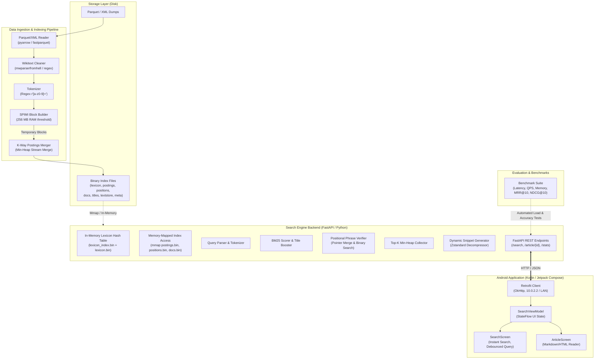
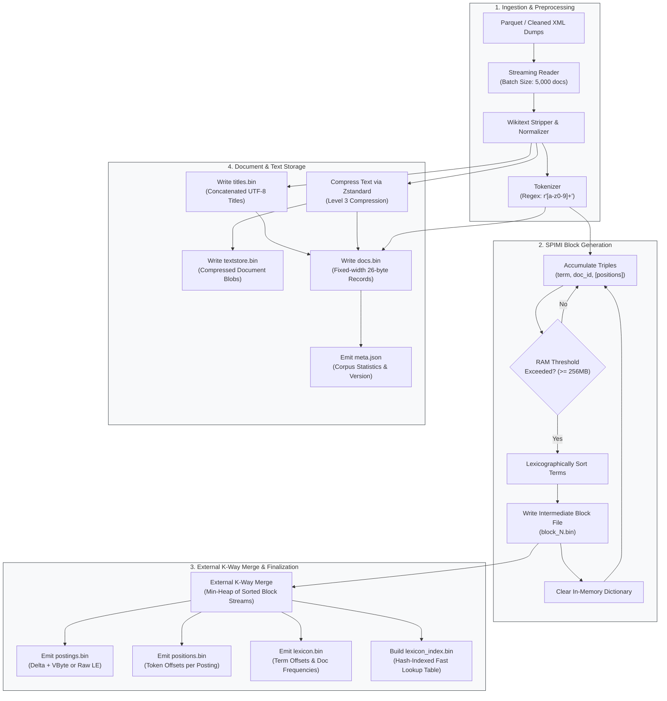
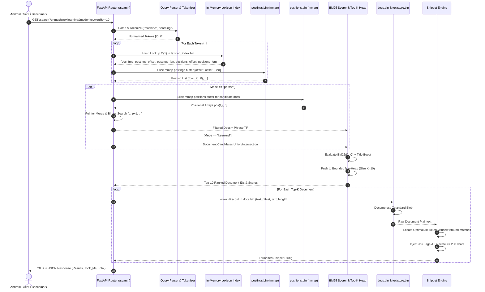
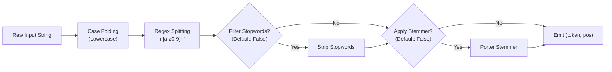
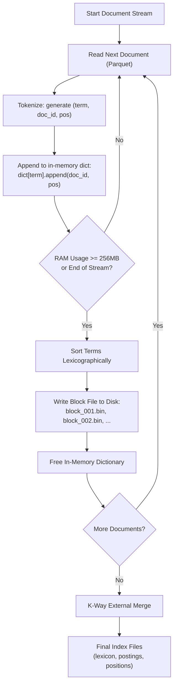
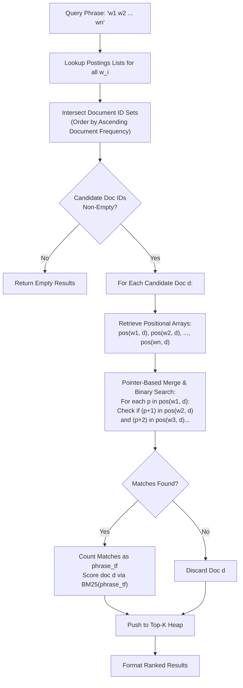
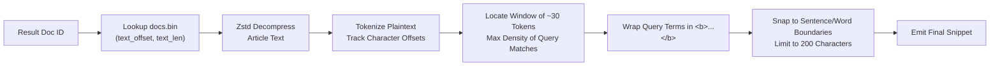
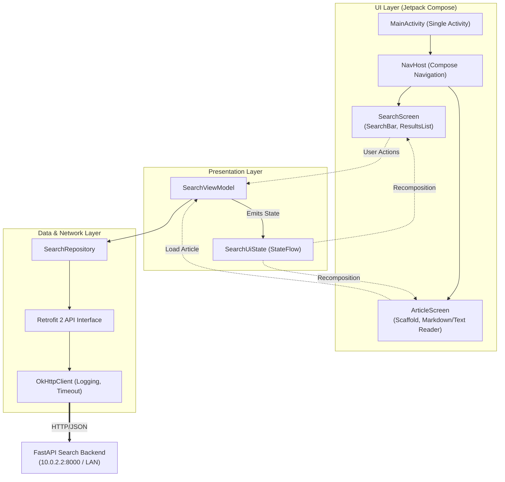
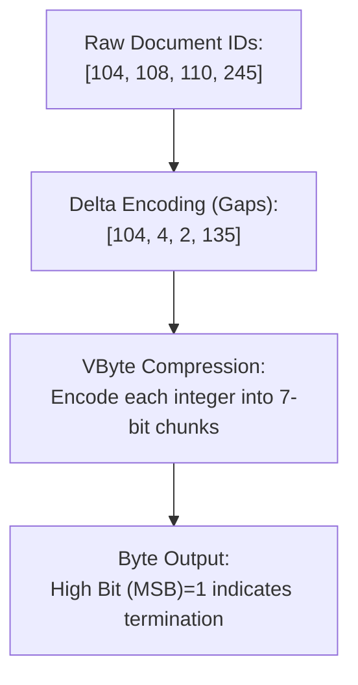

# Local Wikipedia Search Engine — System Architecture & Specification

## 1. System Overview

The Local Wikipedia Search Engine is a self-contained, high-performance information retrieval system designed to index and query full-text Wikipedia dumps (such as Simple English Wikipedia or English Wikipedia slices) entirely on local consumer hardware without third-party search server dependencies (e.g., Elasticsearch, Lucene, or Solr). 

The system implements custom binary index structures, memory-mapped I/O (`mmap`), Single-Pass In-Memory Indexing (SPIMI), positional phrase verification, BM25 scoring with field boosting, dynamic snippet generation, and low-latency client-server interaction over HTTP.



---

## 2. Core System Components

The architecture is partitioned into five decoupled components:

### 2.1. Indexer (`indexer/`)
- **Language / Runtime:** Python 3.10+
- **Primary Libraries:** `pyarrow`, `pandas`, `zstandard`, `struct`, `heapq`
- **Responsibilities:**
  - Streams raw corpus articles directly from compressed Parquet files (or cleaned XML dumps) without loading entire datasets into memory.
  - Normalizes text and generates positional tokens via regex-based scanning.
  - Executes Single-Pass In-Memory Indexing (SPIMI), writing intermediate sorted inverted index runs to disk when memory usage exceeds a configured threshold (default: 256 MB).
  - Performs an external $K$-way merge across all temporary block files to produce final contiguous postings, positions, lexicon, document metadata, title strings, and compressed text stores.
  - Emits metadata metrics (`meta.json`) and the $O(1)$ fast lookup lexicon hash index (`lexicon_index.bin`).

### 2.2. Search Backend (`server/`)
- **Language / Runtime:** Python 3.10+ / FastAPI / Uvicorn (or Gunicorn with Uvicorn workers)
- **Primary Libraries:** `fastapi`, `uvicorn`, `mmap`, `zstandard`, `struct`, `numpy`
- **Responsibilities:**
  - Pre-loads the fast lexicon hash table into virtual memory upon startup for $O(1)$ term metadata retrieval.
  - Establishes read-only `mmap` handles to `postings.bin`, `positions.bin`, and `docs.bin`, delegating page caching directly to the OS kernel.
  - Evaluates free-text queries using the Okapi BM25 algorithm with dynamic document-length normalization and optional title-field scoring boosts.
  - Executes strict phrase matching and proximity filtering using positional lists and pointer-based intersections.
  - Manages a bounded top-$K$ min-heap to return the highest-scoring documents without sorting entire candidate sets.
  - Selectively reads and decompresses document text blocks via `zstandard` on demand to extract query-centric snippets with highlighted tokens (`<b>...</b>`).

### 2.3. Android App (`android/`)
- **Language / Framework:** Kotlin 1.9+ / Jetpack Compose / Android SDK 26+ (Target SDK 34)
- **Architecture:** Unidirectional Data Flow (UDF), Single-Activity Architecture, MVVM (`ViewModel` + `StateFlow`).
- **Networking:** Retrofit 2 + OkHttp 3, configured for both Android Emulator host loopback (`10.0.2.2:8000`) and Local Area Network IP addresses (`192.168.x.x:8000`).
- **Responsibilities:**
  - Responsive search interface offering real-time debounced query submission (300 ms debounce), search mode toggle (Keyword vs. Phrase), and paginated result feeds.
  - Results view displaying title, relevance score, article token count, and formatted snippets with HTML bold tags parsed via Compose AnnotatedStrings.
  - Full article reader displaying decompressed Wikipedia articles with cached navigation history and scroll state preservation.

### 2.4. Benchmark Suite (`benchmarks/`)
- **Language / Runtime:** Python 3.10+ / `pytest` / `locust` / `rich`
- **Responsibilities:**
  - Generates synthetic and real-world Wikipedia query sets (single-word, multi-word conjunctions, exact quotes, and tail queries).
  - Benchmarks query latencies ($p_{50}$, $p_{90}$, $p_{95}$, $p_{99}$), Throughput (QPS), and cold-cache vs. warm-cache memory consumption.
  - Computes standard Information Retrieval (IR) evaluation metrics:
    - **P@K** (Precision at Rank $K$)
    - **MRR** (Mean Reciprocal Rank)
    - **NDCG@K** (Normalized Discounted Cumulative Gain at $K$)

### 2.5. Data Pipeline (`pipeline/` — Optional Tier B)
- **Language / Runtime:** Python 3.10+ / `mwparserfromhell` / `lxml`
- **Responsibilities:**
  - Parses raw Wikipedia XML bz2 dumps (`pages-articles.xml.bz2`) using iterative event-driven XML streaming (`lxml.etree.iterparse`).
  - Strips MediaWiki syntax, templates, infoboxes, file links, inter-wiki links, and references to emit pristine, clean article plaintext.
  - Partitions clean records into columnar Parquet files with snappy/zstd compression for ingestion by the Indexer.

---

## 3. Data Flow & Execution Pipelines

### 3.1. Offline Indexing Data Flow

The offline ingestion pipeline processes raw Parquet or XML files, tokenizes document streams, executes memory-bounded SPIMI block creation, merges runs, and generates final read-optimized binary files.



### 3.2. Query-Time Execution Flow

The online search flow processes client requests via FastAPI, coordinates memory-mapped lookups, computes BM25 relevance scores, resolves positional constraints, and extracts highlighted snippets.



---

## 4. Binary File Formats — Exact Byte Layouts

All binary files adhere to Little-Endian (LE) byte ordering for multi-byte primitives (`u16`, `u32`, `u64`, `f32`, `f64`), ensuring native alignment and zero-overhead deserialization on $x86\_64$ and ARM64 architectures.

```
Index Directory Structure:
d:\wiki\index\
├── meta.json             <- Global corpus metadata and index parameters
├── lexicon.bin           <- Sorted vocabulary entries with binary pointers
├── lexicon_index.bin     <- Hash-indexed O(1) jump table for lexicon terms
├── postings.bin          <- Inverted document index postings (doc_id, tf)
├── positions.bin         <- In-document token position arrays for phrase matching
├── docs.bin              <- Fixed-width 26-byte document descriptor table
├── titles.bin            <- Concatenated raw UTF-8 document titles
└── textstore.bin         <- Individually compressed zstd article bodies
```

---

### 4.1. Metadata File (`meta.json`)
The metadata file is serialized as formatted UTF-8 JSON. It provides global invariant statistics required for Okapi BM25 scoring and validation.

```json
{
  "magic": "WMTA",
  "index_version": 1,
  "num_docs": 269764,
  "num_unique_terms": 892451,
  "avg_doc_length": 185.3412,
  "total_tokens": 49998412,
  "build_time_secs": 145.28,
  "postings_compressed": false,
  "compression_algorithm": "none",
  "created_at": "2026-10-22T09:49:41Z"
}
```

---

### 4.2. Lexicon File (`lexicon.bin`) and Lexicon Hash Index (`lexicon_index.bin`)

#### `lexicon.bin` Structure
The lexicon stores the sorted vocabulary. Each entry points to exact byte ranges in `postings.bin` and `positions.bin`.

##### Global Header (12 Bytes)
| Byte Offset | Field Name | Data Type | Size (Bytes) | Description |
|:---|:---|:---|:---|:---|
| `0x00` | `magic` | `char[4]` | 4 | Magic signature: `b'WLEX'` (`0x57 0x4C 0x45 0x58`) |
| `0x04` | `version` | `u32 LE` | 4 | File format version (`1`) |
| `0x08` | `num_terms` | `u32 LE` | 4 | Total number of unique terms in lexicon |

##### Record Layout (Variable Width, Repeated `num_terms` Times)
Entries are ordered lexicographically by `term_bytes`.

```
+---------------------------------------------------------------------------------------------------------------+
| term_length | term_bytes (variable) | doc_freq | postings_offset | postings_byte_len | positions_offset | positions_byte_len |
|   (2 B)     |  (term_length Bytes)  |  (4 B)   |     (8 B)       |      (4 B)        |     (8 B)        |       (4 B)        |
+---------------------------------------------------------------------------------------------------------------+
```

| Field Name | Data Type | Size (Bytes) | Description |
|:---|:---|:---|:---|
| `term_length` | `u16 LE` | 2 | Byte length $L$ of the UTF-8 encoded term string |
| `term_bytes` | `u8[L]` | $L$ | Raw UTF-8 string bytes (not null-terminated) |
| `doc_freq` | `u32 LE` | 4 | Document Frequency ($df$): count of documents containing this term |
| `postings_offset` | `u64 LE` | 8 | Absolute byte offset in `postings.bin` where this posting list begins |
| `postings_byte_length` | `u32 LE` | 4 | Total byte length of the term's posting list slice in `postings.bin` |
| `positions_offset` | `u64 LE` | 8 | Absolute byte offset in `positions.bin` where positional data begins |
| `positions_byte_length`| `u32 LE` | 4 | Total byte length of the term's positional slice in `positions.bin` |

- **Fixed overhead per term:** $2 + 4 + 8 + 4 + 8 + 4 = 30\text{ bytes}$ (plus $L$ bytes for term string).

---

#### `lexicon_index.bin` Structure (O(1) Hash Map)
To avoid performing an $O(\log M)$ binary search over variable-width strings in `lexicon.bin`, an auxiliary static hash index is generated.

##### Hash Table Layout
The file is an array of $S$ fixed-width buckets, where $S$ is the smallest prime $\ge 2 \times \text{num\_terms}$ (load factor $\le 0.5$). Collisions are resolved using open addressing with linear probing.

##### Global Header (16 Bytes)
| Byte Offset | Field Name | Data Type | Size (Bytes) | Description |
|:---|:---|:---|:---|:---|
| `0x00` | `magic` | `char[4]` | 4 | Magic signature: `b'WLXI'` |
| `0x04` | `version` | `u32 LE` | 4 | Version identifier (`1`) |
| `0x08` | `capacity` | `u64 LE` | 8 | Total slot count $S$ in the hash table |

##### Bucket Slot Layout (16 Bytes per Slot)
| Offset within Slot | Field Name | Data Type | Size (Bytes) | Description |
|:---|:---|:---|:---|:---|
| `0x00` | `hash_key` | `u64 LE` | 8 | 64-bit FNV-1a (or xxHash64) of the term string (`0` indicates empty slot) |
| `0x08` | `lexicon_offset` | `u64 LE` | 8 | Absolute byte offset pointing directly to the entry in `lexicon.bin` |

```
Hash Index Lookup Procedure:
1. Compute h = xxHash64(query_token)
2. slot = h % capacity
3. while table[slot].hash_key != 0:
       if table[slot].hash_key == h:
           read term from lexicon.bin at table[slot].lexicon_offset
           if term == query_token:
               return lexicon entry
       slot = (slot + 1) % capacity
4. return TermNotFound
```

---

### 4.3. Postings File (`postings.bin`)

#### Uncompressed Format
Stores document IDs and term frequencies contiguously.

##### Global Header (8 Bytes)
| Byte Offset | Field Name | Data Type | Size (Bytes) | Description |
|:---|:---|:---|:---|:---|
| `0x00` | `magic` | `char[4]` | 4 | Magic signature: `b'WPOS'` (`0x57 0x50 0x4F 0x53`) |
| `0x04` | `version` | `u32 LE` | 4 | Version identifier (`1` = uncompressed, `2` = VByte) |

##### Term Postings Chunk (At `postings_offset` for a term)
For a term with document frequency $df$, the chunk consists of exactly $df$ contiguous 6-byte elements:
```
+-----------------------------------+-----------------------------------+
|      doc_id_0    |    term_freq_0 |      doc_id_1    |    term_freq_1 | ...
|   (u32 LE, 4 B)  |   (u16 LE, 2 B)|   (u32 LE, 4 B)  |   (u16 LE, 2 B)|
+-----------------------------------+-----------------------------------+
```
- Each posting occupies $4 + 2 = 6\text{ bytes}$.
- `postings_byte_length` in lexicon equals $df \times 6\text{ bytes}$.

---

#### Compressed Format (Tier D: Delta + VByte)
When `version == 2`, postings are stored using gap (delta) encoding on sorted `doc_id` values, followed by Variable Byte (VByte) integer serialization:

```
+-----------------------------------------------------------------------------+
| vbyte_compressed_doc_deltas (variable) | vbyte_compressed_term_frequencies |
+-----------------------------------------------------------------------------+
```
- $\Delta_0 = \text{doc\_id}_0$
- $\Delta_i = \text{doc\_id}_i - \text{doc\_id}_{i-1} \quad (\forall i \ge 1)$
- Frequencies are encoded directly as raw VByte integers.

---

### 4.4. Positions File (`positions.bin`)
The positions file contains 0-based token offsets within each document, enabling phrase validation and proximity queries.

##### Global Header (8 Bytes)
| Byte Offset | Field Name | Data Type | Size (Bytes) | Description |
|:---|:---|:---|:---|:---|
| `0x00` | `magic` | `char[4]` | 4 | Magic signature: `b'WPSN'` (`0x57 0x50 0x53 0x4E`) |
| `0x04` | `version` | `u32 LE` | 4 | Version identifier (`1`) |

##### Chunk Layout for a Term (At `positions_offset`)
The chunk consists of a sequence of entries corresponding 1-to-1 with the documents in the term's posting list:

```
Doc 0: [ num_positions: u16 LE ] [ pos_0: u32 LE ] [ pos_1: u32 LE ] ... [ pos_N: u32 LE ]
Doc 1: [ num_positions: u16 LE ] [ pos_0: u32 LE ] ...
...
Doc (df - 1): ...
```

| Field Name | Data Type | Size (Bytes) | Description |
|:---|:---|:---|:---|
| `num_positions` | `u16 LE` | 2 | Count $P$ of occurrences of the term in this document (equals $tf$) |
| `positions` | `u32 LE[P]` | $P \times 4$ | Sorted array of 0-based token index positions within document |

- Total byte size for doc entry: $2 + (P \times 4)\text{ bytes}$.

---

### 4.5. Document Table (`docs.bin`)
A dense, fixed-width table indexed directly by `doc_id` ($0 \le \text{doc\_id} < \text{num\_docs}$). To access document $D$, the search engine reads directly from file offset $12 + (D \times 26)$.

##### Global Header (12 Bytes)
| Byte Offset | Field Name | Data Type | Size (Bytes) | Description |
|:---|:---|:---|:---|:---|
| `0x00` | `magic` | `char[4]` | 4 | Magic signature: `b'WDOC'` (`0x57 0x44 0x4F 0x43`) |
| `0x04` | `version` | `u32 LE` | 4 | Version identifier (`1`) |
| `0x08` | `num_docs` | `u32 LE` | 4 | Total number of indexed documents |

##### Record Layout (Exactly 26 Bytes per Document)
```
+-----------------------------------------------------------------------------------+
| title_offset | title_length | doc_length | text_offset | text_length (compressed) |
| (u64 LE, 8B) | (u16 LE, 2B) |(u32 LE, 4B)|(u64 LE, 8B) |       (u32 LE, 4B)       |
+-----------------------------------------------------------------------------------+
```

| Field Name | Data Type | Size (Bytes) | Description |
|:---|:---|:---|:---|
| `title_offset` | `u64 LE` | 8 | Byte offset in `titles.bin` where the title string begins |
| `title_length` | `u16 LE` | 2 | Byte length of the title string |
| `doc_length` | `u32 LE` | 4 | Total number of tokens in this document ($|D|$) |
| `text_offset` | `u64 LE` | 8 | Byte offset in `textstore.bin` where compressed text begins |
| `text_length` | `u32 LE` | 4 | Byte length of the compressed text blob in `textstore.bin` |

- **Total record width:** $8 + 2 + 4 + 8 + 4 = 26\text{ bytes}$.

---

### 4.6. Titles Store (`titles.bin`)
Raw concatenated UTF-8 encoded title strings without delimiters or null terminators.
- Size: Exactly equal to the sum of all `title_length` fields across all documents.
- Lookup: Document $d$ title is obtained by slicing:
  $$\text{titles\_mmap}[\text{title\_offset} : \text{title\_offset} + \text{title\_length}].\text{decode}(\text{"utf-8"})$$

---

### 4.7. Text Store (`textstore.bin`)
Contiguous blocks of independently compressed article text using Zstandard (`zstd`, compression level 3).
- Individual per-document compression allows random-access retrieval without decompressing neighboring articles.
- Lookup: Document $d$ plaintext is obtained via:
  $$\text{zstd.decompress}(\text{textstore\_mmap}[\text{text\_offset} : \text{text\_offset} + \text{text\_length}])$$

---

## 5. Ranking & Scoring: BM25 Algorithm

The search backend implements the industry-standard Okapi BM25 probabilistic relevance model with length normalization and optional title-field scoring boosts.

### 5.1. Mathematical Formula

For a parsed query $Q = \{t_1, t_2, \dots, t_m\}$ and document $D$:

$$\text{score}(D, Q) = \sum_{t \in Q} \text{IDF}(t) \times \frac{f(t, D) \cdot (k_1 + 1)}{f(t, D) + k_1 \cdot \left(1 - b + b \cdot \frac{|D|}{\text{avgdl}}\right)}$$

where:
- $f(t, D)$ is the raw term frequency of term $t$ in document $D$ (retrieved directly from `postings.bin`).
- $|D|$ is the token length of document $D$ (retrieved from `docs.bin`).
- $\text{avgdl}$ is the average document token length across the entire corpus:
  $$\text{avgdl} = \frac{\sum_{d \in C} |d|}{N}$$
- $N$ is the total number of documents in the index (`num_docs`).
- $df(t)$ is the document frequency of term $t$ (number of documents containing $t$).
- $\text{IDF}(t)$ is the Robertson-Spärck Jones Inverse Document Frequency with smoothing:
  $$\text{IDF}(t) = \ln\left(\frac{N - df(t) + 0.5}{df(t) + 0.5} + 1\right)$$

```
                                  f(t, D) * (k1 + 1)
BM25 Score =  ∑  IDF(t)  *  ------------------------------------
             t∈Q            f(t, D) + k1 * (1 - b + b * (|D| / avgdl))
```

### 5.2. Hyperparameter Rationale
- **$k_1 = 1.2$ (Term Saturation Parameter):** Controls the non-linear saturation rate of term frequency. As $f(t, D)$ increases, the marginal gain of additional term occurrences diminishes asymptotically toward $(k_1 + 1)$. A value of $1.2$ is optimal for encyclopedia articles, preventing long documents with repetitive terms from dominating short, highly focused articles.
- **$b = 0.75$ (Document Length Normalization):** Penalizes documents that are longer than $\text{avgdl}$. At $b = 1.0$, term frequency is scaled entirely by relative length; at $b = 0.0$, length normalization is disabled. The value $0.75$ balances long multi-topic articles against concise summary articles.

### 5.3. Title-Field Boosting
Document titles carry significantly higher semantic weight than body text. To incorporate title matches without storing separate title postings, the system tokenizes the title during scoring or evaluates title matches on top candidates:

$$\text{score}_{\text{final}}(D, Q) = \text{score}_{\text{body}}(D, Q) + \alpha \times \text{score}_{\text{title}}(D, Q)$$

- Default boost parameter: $\alpha = 2.0$.
- If an exact phrase query matches the title, an additional priority bonus ($+5.0$) is applied to place exact title matches at the top of the result list.

---

## 6. Tokenization Specification

Both index-time ingestion and query-time processing execute an identical tokenization pipeline to prevent vocabulary mismatch.



### 6.1. Tokenization Rules
1. **Lowercase Conversion:** Transform all characters to lowercase via Unicode standard lowercase mapping.
2. **Regex Splitting:** Extract matching token slices via regular expression:
   ```python
   TOKEN_REGEX = re.compile(r'[a-z0-9]+')
   ```
   - Matches alphanumeric sequences.
   - Punctuation, symbols, whitespace, and formatting markers (e.g., `[[`, `]]`, `==`, `\n`) are discarded as delimiters.
3. **Positional Tracking:** Each emitted token is paired with its 0-based sequential token index within the document:
   $$\text{tokens} = [(t_0, 0), (t_1, 1), (t_2, 2), \dots, (t_n, n)]$$
4. **Stopwords (Configurable, Default: Disabled):** Stopwords are retained by default to maintain positional integrity for phrase queries (e.g., "to be or not to be" requires retaining stopwords).
5. **Stemming (Configurable, Default: Disabled):** Porter stemming is disabled by default to preserve precise word matching and exact phrase searches.

---

## 7. SPIMI (Single-Pass In-Memory Indexing)

The indexer employs the Single-Pass In-Memory Indexing (SPIMI) algorithm. SPIMI eliminates document-term sorting bottlenecks by dynamically accumulating postings into memory-resident dictionaries until a memory threshold is reached, spilling sorted runs to disk.



### 7.1. SPIMI Inversion Algorithm Step-by-Step
1. Initialize an empty hash map: `postings_dict: Dict[str, List[Tuple[int, List[int]]]]`.
2. For each document $(d, \text{text})$:
   - Extract `[(term_0, pos_0), (term_1, pos_1), ...]`.
   - Aggregate term counts and positions for document $d$.
   - Append `(d, [pos_list])` to `postings_dict[term]`.
3. Monitor heap memory allocation. When allocated memory reaches the limit ($256\text{ MB}$):
   - Sort dictionary keys (terms) alphabetically: $T_{\text{sorted}} = \text{sorted}(\text{postings\_dict.keys()})$.
   - Serialize the run to a temporary file `block_<index>.bin`.
   - Clear `postings_dict` and trigger Python garbage collection (`gc.collect()`).
4. Repeat until all documents are consumed.

### 7.2. Multi-Way External Merge ($K$-Way Merge)
Once all intermediate block files are written:
1. Open read streams to all $K$ block files simultaneously.
2. Initialize a min-heap storing the head term of each block:
   $$\text{heap} = [(T_i.\text{current\_term}, i) \quad \forall i \in [0, K-1]]$$
3. Pop the minimum term $T_{\min}$. Collect and concatenate all postings and positions for $T_{\min}$ from all blocks sharing this term.
4. Record current file positions in `postings.bin` and `positions.bin`.
5. Write contiguous postings and positions slices to disk.
6. Write the completed entry for $T_{\min}$ to `lexicon.bin`.
7. Advance readers for contributing blocks and replenish the min-heap.
8. When the heap is exhausted, close all streams and generate `lexicon_index.bin`.

---

## 8. Phrase Matching Algorithm

Phrase queries (enclosed in quotation marks or selected via `mode=phrase`, e.g., `"computer science"`) require all terms to appear consecutively in the specified order.



### 8.1. Candidate Document Selection
1. Look up posting lists $P(w_1), P(w_2), \dots, P(w_n)$ from `postings.bin`.
2. Sort posting lists in ascending order of document frequency $df(w_i)$.
3. Perform set intersection across document IDs:
   $$D_{\text{candidates}} = \bigcap_{i=1}^n \text{docs}(w_i)$$
   Because lists are sorted by `doc_id`, intersection takes $O(\sum |P(w_i)|)$ using two-pointer scans.

### 8.2. Positional Verification (Pointer & Binary Search)
For each candidate document $d \in D_{\text{candidates}}$:
1. Read positional arrays $L_1 = \text{pos}(w_1, d), L_2 = \text{pos}(w_2, d), \dots, L_n = \text{pos}(w_n, d)$ from `positions.bin`.
2. Initialize `phrase_tf = 0`.
3. For each start position $p \in L_1$:
   - For step $k = 1$ to $n-1$:
     - Check if target position $(p + k)$ exists in $L_{k+1}$ using binary search (`bisect_left`).
     - If not found, break early.
   - If all $(p + k)$ exist, increment `phrase_tf += 1`.
4. If `phrase_tf > 0`, calculate the document's phrase BM25 score using `phrase_tf` as the effective term frequency.

---

## 9. Dynamic Snippet Generation & Highlighting

To generate informative search previews without pre-computing summaries, snippets are dynamically extracted from the compressed text store on demand.



### 9.1. Window Selection Algorithm
1. Read `(text_offset, text_length)` from `docs.bin` for result document $d$.
2. Decompress raw article text using Zstandard.
3. Tokenize decompressed text, recording start and end character offsets for each token.
4. Identify all token positions that match query terms.
   - For phrase queries, identify the exact starting position of the phrase match.
5. Apply a sliding window of $W = 30$ tokens over the text:
   $$\text{window\_score}(i) = \sum_{j=i}^{i+W} \text{weight}(t_j)$$
   where $\text{weight}(t_j)$ assigns higher scores to query terms and distinct matched tokens.
6. Select window $i^*$ with the maximum score.

### 9.2. Formatting & Truncation
1. Expand window edges to sentence boundaries (`.`, `!`, `?`) or space delimiters.
2. Enclose matched query terms within HTML bold tags: `<b>term</b>`.
3. If context exceeds 200 characters, truncate at the nearest whitespace boundary and append ellipsis (`...`).

---

## 10. RESTful API Contract

The Search Backend exposes a high-performance REST API built with FastAPI.

### 10.1. `GET /search`
Executes free-text keyword or exact phrase search.

#### Query Parameters
| Parameter | Type | Required | Default | Constraints | Description |
|:---|:---|:---|:---|:---|:---|
| `q` | `string` | **Yes** | — | Non-empty string | Raw search query |
| `mode` | `string` | No | `keyword` | `keyword` \| `phrase` | Search evaluation mode |
| `k` | `integer` | No | `10` | $1 \le k \le 100$ | Number of results to return |

#### Response `200 OK`
```json
{
  "query": "hello world",
  "mode": "keyword",
  "took_ms": 12.5,
  "total": 1523,
  "results": [
    {
      "id": 42,
      "title": "\"Hello, World!\" program",
      "score": 8.723,
      "snippet": "...the classic <b>Hello</b> <b>World</b> program is often used to introduce beginners...",
      "rank": 1
    },
    {
      "id": 891,
      "title": "Computer programming",
      "score": 5.412,
      "snippet": "...most introductory tutorials start with a <b>hello</b> <b>world</b> example...",
      "rank": 2
    }
  ]
}
```

---

### 10.2. `GET /article/{id}`
Retrieves full article content and metadata for reader view.

#### Path Parameters
| Parameter | Type | Required | Description |
|:---|:---|:---|:---|
| `id` | `integer` | **Yes** | Document ID ($0 \le \text{id} < \text{num\_docs}$) |

#### Response `200 OK`
```json
{
  "id": 42,
  "title": "\"Hello, World!\" program",
  "text": "A \"Hello, World!\" program is traditionally used to introduce beginners to a programming language...",
  "length": 245,
  "attribution": "Content from Simple English Wikipedia, licensed under CC BY-SA 4.0"
}
```

---

### 10.3. `GET /stats`
Returns system index statistics, memory footprint, and compression status.

#### Response `200 OK`
```json
{
  "num_docs": 269764,
  "num_unique_terms": 892451,
  "avg_doc_length": 185.3,
  "total_tokens": 49982100,
  "index_size_bytes": 524288000,
  "index_size_human": "500.0 MB",
  "build_time_secs": 145.2,
  "compression_ratio": 0.38,
  "postings_compressed": false
}
```

---

### 10.4. Error Responses

#### `400 Bad Request`
Returned when mandatory parameters are missing or invalid.
```json
{
  "error": "query parameter q is required"
}
```

#### `404 Not Found`
Returned when requesting an article ID outside valid range.
```json
{
  "error": "article not found"
}
```

---

## 11. Android Client Architecture

The mobile client is implemented as a modern native Android application using 100% Kotlin and Jetpack Compose.



### 11.1. Component Design
- **Single-Activity Architecture:** `MainActivity` hosts the Jetpack Compose `NavHost` containing two routes:
  - `"search"`: Search query input, filter chips (Keyword vs. Phrase), and dynamic scrollable results feed.
  - `"article/{articleId}"`: Full article reader with back navigation, scroll state persistence, and typography controls.
- **ViewModel & StateFlow:** `SearchViewModel` manages asynchronous UI state via Kotlin Coroutines. State is exposed to Compose via read-only `StateFlow<SearchUiState>`:
  ```kotlin
  data class SearchUiState(
      val query: String = "",
      val isPhraseMode: Boolean = false,
      val isLoading: Boolean = false,
      val results: List<SearchResultItem> = emptyList(),
      val errorMessage: String? = null
  )
  ```
- **Retrofit Service Definition:**
  ```kotlin
  interface WikiSearchService {
      @GET("search")
      suspend fun search(
          @Query("q") query: String,
          @Query("mode") mode: String = "keyword",
          @Query("k") limit: Int = 10
      ): SearchResponse

      @GET("article/{id}")
      suspend fun getArticle(
          @Path("id") articleId: Int
      ): ArticleResponse

      @GET("stats")
      suspend fun getStats(): StatsResponse
  }
  ```
- **Network Configuration:**
  - **Android Emulator:** Connects to host search backend via `http://10.0.2.2:8000/`.
  - **Physical Devices (LAN):** Configurable base URL preference allowing direct connection to the host machine's local IP (e.g., `http://192.168.1.150:8000/`).
  - `AndroidManifest.xml` includes `android:usesCleartextTraffic="true"` for seamless local development.

---

## 12. Inverted Index Compression (Tier D)

To scale to multi-million document dumps on resource-constrained devices, the system provides Tier D compression for `postings.bin` using delta encoding and Variable Byte (VByte) serialization.



### 12.1. Delta (Gap) Encoding
Because posting lists are ordered by strictly increasing document IDs:
$$[\text{doc}_0, \text{doc}_1, \text{doc}_2, \dots, \text{doc}_k]$$
we store gaps $\Delta_i$:
$$\Delta_0 = \text{doc}_0, \quad \Delta_i = \text{doc}_i - \text{doc}_{i-1} \quad (i \ge 1)$$
Since $\Delta_i \ge 1$, gap values are substantially smaller than raw IDs, allowing compact representation in 1 or 2 bytes instead of 4 bytes.

### 12.2. Variable Byte (VByte) Specification
Variable Byte encodes non-negative integers into a sequence of 7-bit payload bytes. The Most Significant Bit (MSB, bit 7) serves as the continuation marker:
- **Bit 7 = 0:** More bytes follow for this integer.
- **Bit 7 = 1:** Terminal byte (end of integer).

```
VByte Bit Allocation:
+---+---+---+---+---+---+---+---+
| C | b6| b5| b4| b3| b2| b1| b0|   (C = Continuation Bit: 0 = continue, 1 = terminal)
+---+---+---+---+---+---+---+---+
```

#### Example Value Encodings
- **Value = 53** ($< 128$):
  - Binary: `0110101`
  - Encoded: `10110101` (`0xB5`) — 1 byte.
- **Value = 135** ($\ge 128$):
  - Low 7 bits: $135 \pmod{128} = 7$ (`0000111`) $\rightarrow$ continuation `0`: `00000111` (`0x07`).
  - Next 7 bits: $\lfloor 135 / 128 \rfloor = 1$ (`0000001`) $\rightarrow$ terminal `1`: `10000001` (`0x81`).
  - Encoded bytes: `[0x07, 0x81]` — 2 bytes.

### 12.3. PForDelta (Patched Frame of Reference)
For high-density posting lists, PForDelta compresses blocks of 128 integers:
- Determines a bit-width $b$ that accommodates $90\%$ of gap values.
- Packs the $90\%$ values into $b$-bit slots.
- Stores the remaining $10\%$ exceptions in an overflow area at the end of the block.
- Delivers decompression speeds exceeding 1–2 GB/s utilizing SIMD registers.

### 12.4. Storage Footprint Comparison (Simple English Wikipedia ~270K Documents)

| Index Component | Uncompressed (Raw LE) | Tier D Compressed (Delta + VByte) | Reduction Ratio |
|:---|:---|:---|:---|
| `lexicon.bin` + index | ~38 MB | ~38 MB | 1.00 (Unchanged) |
| `postings.bin` | ~240 MB | ~65 MB | **3.69x (73% saving)** |
| `positions.bin` | ~450 MB | ~190 MB (Delta VByte) | **2.36x (58% saving)** |
| `docs.bin` (fixed 26B) | ~7.0 MB | ~7.0 MB | 1.00 (Direct indexing) |
| `titles.bin` | ~6.5 MB | ~6.5 MB | 1.00 |
| `textstore.bin` (zstd) | ~145 MB | ~145 MB | 1.00 (Pre-compressed) |
| **Total Footprint** | **~886.5 MB** | **~451.5 MB** | **1.96x Overall Reduction** |

---

## 13. System Invariants & Design Principles

1. **Deterministic Reproducibility:** Building an index twice from the same corpus produces identical bitstreams and hashes.
2. **Zero Ingestion Crashes via Bounded RAM:** The SPIMI builder enforces a hard memory cap ($256\text{ MB}$ default), guaranteeing successful index construction on low-memory systems (e.g., Raspberry Pi, budget laptops).
3. **Zero Dynamic Allocation at Query Time:** Postings and positions data are read directly from read-only memory mappings (`mmap`), allowing the OS kernel to cache hot pages dynamically.
4. **Vocabulary Parity:** Query tokenization and index tokenization share identical regex patterns, ensuring every indexed token is queryable.
5. **Decoupled Client & Server:** The search server operates as a stateless HTTP JSON API, allowing independent upgrades of the Android client, benchmarking suites, or future web interfaces.
