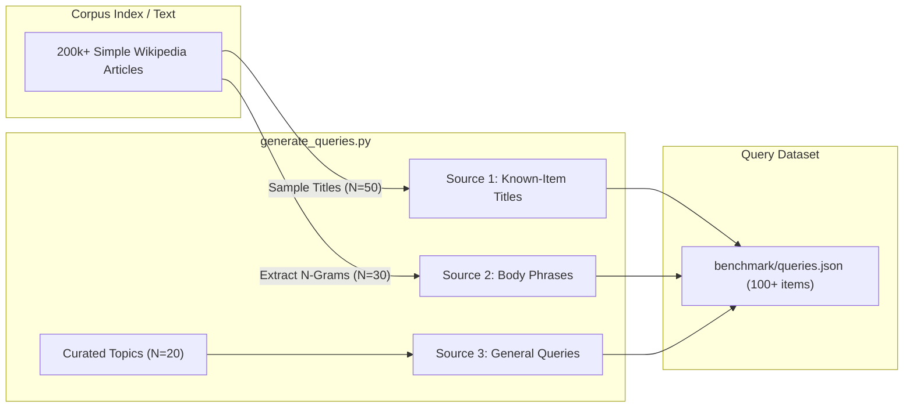
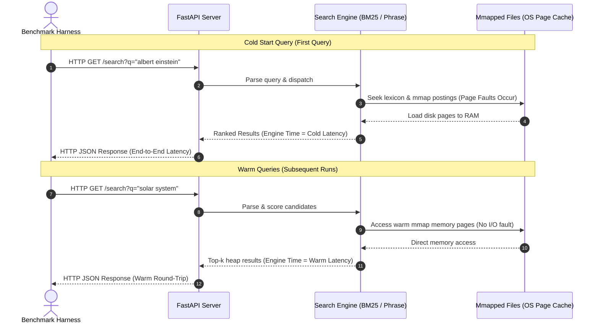
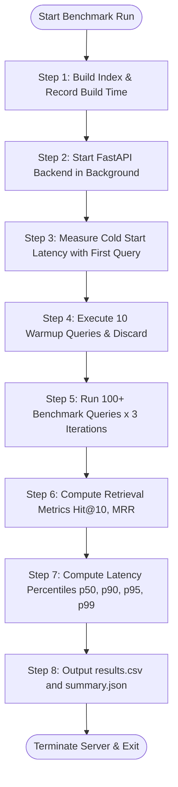

# Benchmark Methodology and Evaluation Plan

This document establishes the empirical evaluation framework for the **Local Wikipedia Search Engine**. It specifies the query generation strategy, quantitative retrieval and system metrics, rigorous execution procedures, target service-level objectives (SLOs), and reporting templates.

---

## 1. Query Generation Strategy

To ensure evaluation rigor across both ranking quality and execution efficiency, the benchmark uses a stratified query set composed of known-item title searches, multi-term exact phrases extracted from article text, and thematic topic queries.

All generated queries are stored in [`benchmark/queries.json`](file:///d:/wiki/benchmark/queries.json).



### 1.1 Query Sources & Composition

| Source Identifier | Count | Mode | Generation Strategy & Selection Criteria | Expected Ground Truth |
| :--- | :--- | :--- | :--- | :--- |
| **Source 1: Known-Item Titles** | 50 | `keyword` | Uniform random sampling of Wikipedia article titles (length 1–4 words, excluding disambiguation pages and redirects). Fixed seed (`seed=42`). | `expected_doc_id` and `expected_title` must be set to the source article. |
| **Source 2: Body Phrases** | 30 | `phrase` | Extraction of distinctive 2-to-3 word n-grams from article bodies with collection frequency $cf \in [5, 200]$ (filtering out stopwords and boilerplate). | `expected_doc_id` set to the originating document containing the exact n-gram. |
| **Source 3: General Topic Queries** | 20 | `keyword` | Hand-crafted thematic searches reflecting common informational user intents (e.g., `"solar system"`, `"world war"`, `"python programming"`, `"artificial intelligence"`, `"plate tectonics"`). | Broad informational recall; top-10 evaluated for qualitative topic relevance. |
| **Total Query Set** | **100+** | **Mixed** | Automated output of [`benchmark/generate_queries.py`](file:///d:/wiki/benchmark/generate_queries.py). | Evaluated against Hit@10, MRR, and Latency percentiles. |

### 1.2 Schema Definition (`queries.json`)

The test suite consumes a JSON array conforming to the following JSON schema:

```json
[
  {
    "query_id": "title_042",
    "query_text": "Albert Einstein",
    "mode": "keyword",
    "expected_doc_id": 14023,
    "expected_title": "Albert Einstein"
  },
  {
    "query_id": "phrase_018",
    "query_text": "\"theory of general relativity\"",
    "mode": "phrase",
    "expected_doc_id": 14023,
    "expected_title": "Albert Einstein"
  },
  {
    "query_id": "topic_007",
    "query_text": "solar system planets",
    "mode": "keyword",
    "expected_doc_id": null,
    "expected_title": null
  }
]
```

### 1.3 Generation Algorithm (`generate_queries.py`)

1. Load `titles.bin` and `docs.bin` using a deterministic random number generator seed (`random.seed(42)`).
2. Filter titles to those between 5 and 40 characters without parentheses (excluding disambiguation suffixes).
3. Sample 50 titles for known-item retrieval.
4. Scan random document text blocks from `textstore.bin` for 2–3 token sequences where each token length $\ge 3$ and contains no punctuation. Verify via positional index that the n-gram occurs in at least 2 but no more than 250 documents. Sample 30 distinct phrases.
5. Append 20 predefined curated topic queries.
6. Write formatted JSON to [`benchmark/queries.json`](file:///d:/wiki/benchmark/queries.json).

---

## 2. Evaluation Metrics & Definitions

The benchmark evaluates both **Information Retrieval (IR) Effectiveness** and **System Performance & Resource Consumption**.

### 2.1 Information Retrieval (IR) Metrics

#### 1. Hit@10 (Success Rate at Rank 10)
Measures the proportion of known-item evaluation queries where the ground-truth document appears within the top-10 ranked results returned by the engine.

$$\text{Hit@10} = \frac{1}{|Q_k|} \sum_{q \in Q_k} \mathbb{I}(\text{rank}(q) \le 10)$$

Where:
* $Q_k$ is the set of known-item queries (Source 1 and Source 2).
* $\text{rank}(q)$ is the 1-based rank position of `expected_doc_id`. If the document is not retrieved or ranked $> 10$, $\mathbb{I}(\dots) = 0$.
* **Target Objective**: $> 0.90$ ($90\%$ of expected articles present in the first page of results).

#### 2. Mean Reciprocal Rank (MRR)
Evaluates ranking quality by rewarding engines that place the target document at the very top of the result list.

$$\text{MRR} = \frac{1}{|Q_k|} \sum_{q \in Q_k} \frac{1}{\text{rank}(q)}$$

Where $\frac{1}{\text{rank}(q)} = 0$ if the expected document is not retrieved in the result list (top-50 candidates).
* **Target Objective**: $> 0.70$ (average position within the top 1.4 ranks).

---

### 2.2 Latency & Throughput Metrics

All latency measurements are tracked in milliseconds ($ms$) using high-resolution monotonic timers (`time.perf_counter_ns()`).



#### 3. p50 Latency (Median Latency)
The median server-side query processing duration across warm benchmark runs.
* **Scope**: Server engine time (query tokenization + posting retrieval + BM25 heap scoring + snippet generation).
* **Target Objective**: $< 50\text{ ms}$.

#### 4. p95 Latency (95th Percentile)
The 95th percentile latency representing tail latency under query term disjunction with high document frequencies.
* **Target Objective**: $< 200\text{ ms}$.

#### 5. Cold Latency
The execution time of the very first query executed immediately after backend process initialization. Measures un-cached OS page fault overhead when accessing memory-mapped posting tables (`postings.bin`, `positions.bin`, `lexicon.bin`).
* **Reporting**: Recorded as an independent baseline metric (not mixed into warm distribution statistics).

#### 6. Warm Latency
Query latencies measured after executing 10 un-timed warmup queries to pre-fault lexicon tables into the operating system page cache.
* **Target Objective**: Primary operational metric reported in p50, p90, p95, and p99 percentiles.

#### 7. End-to-End Latency (Client-Side Round Trip)
Total elapsed time measured by [`benchmark/run_benchmark.py`](file:///d:/wiki/benchmark/run_benchmark.py) from sending the HTTP GET request over TCP socket to receiving and deserializing the complete JSON response payload.
* **Captures**: Network serialization, ASGI loop handling, JSON decoding overhead, and client HTTP socket overhead.

---

### 2.3 Index Construction & Storage Metrics

#### 8. Build Time
Total wall-clock time required to execute [`indexer/build.py`](file:///d:/wiki/indexer/build.py) from uncompressed raw data to final binary index files.
* **Includes**: Text reading, tokenization, SPIMI memory accumulation, block flushes, external $K$-way merge, and binary file packing.
* **Target Objective**: $< 5\text{ minutes}$ for Simple English Wikipedia (~250,000 articles).

#### 9. Index Size
Total combined byte size on disk of all generated binary index files:
$$\text{Index Size} = \sum \text{sizeof}(f) \quad \text{for } f \in \{\texttt{lexicon.bin}, \texttt{lexicon\_index.bin}, \texttt{postings.bin}, \texttt{positions.bin}, \texttt{docs.bin}, \texttt{titles.bin}, \texttt{textstore.bin}\}$$
* Evaluated both for uncompressed posting lists and compressed (Tier D: Delta + VByte) variants.

#### 10. Size Ratio & Compression Ratio
* **Raw Size Ratio**: $\frac{\text{Total Index Size}}{\text{Original Uncompressed Text Size}}$
* **Posting Compression Ratio (Tier D)**: $\frac{\text{Uncompressed Postings Size}}{\text{Compressed Postings Size}}$

---

## 3. Benchmark Execution Procedure

To guarantee repeatability, the benchmark execution follows a strictly scripted protocol.



### 3.1 Step-by-Step Instructions

#### Step 1: Clean Build
Execute the index builder and capture wall-clock timing:
```powershell
python indexer/build.py --input data/raw/simplewiki/ --output data/index/ --compress
```
Record build elapsed duration, token counts, and disk footprints.

#### Step 2: Server Initialization
Launch the FastAPI server daemon listening on `http://127.0.0.1:8000`:
```powershell
uvicorn backend.main:app --host 127.0.0.1 --port 8000
```
Verify the server is healthy by querying `GET /stats`.

#### Step 3: Cold Query Measurement
Send an initial search request for a known multi-term query (e.g., `q=scientific+methodology`) before any other requests touch the index. Record the server engine latency and client round-trip as **Cold Latency**.

#### Step 4: Page Cache Warmup
Execute 10 disposable queries spanning popular terms (`the`, `united`, `history`, `world`, `science`) to ensure essential lexicon headers and OS file table structures are active in the file system cache. Discard these results.

#### Step 5: Triplicate Benchmark Execution
Run [`benchmark/run_benchmark.py`](file:///d:/wiki/benchmark/run_benchmark.py):
* Iterate through every query in [`benchmark/queries.json`](file:///d:/wiki/benchmark/queries.json).
* Repeat the entire query set for 3 consecutive iterations (shuffling query order per iteration to avoid artificial pipelining artifacts).
* Record each execution's metrics: `query_id`, `iteration`, `mode`, `engine_latency_ms`, `e2e_latency_ms`, `top_10_doc_ids`, `expected_doc_id`, `hit_at_10`, `reciprocal_rank`.

#### Step 6: Statistical Analysis & Output Serialization
* Group records by query mode (`keyword` vs. `phrase` vs. `all`).
* Calculate Hit@10 and MRR over known-item queries.
* Compute p50, p90, p95, p99 latency percentiles.
* Save the full execution log to [`benchmark/results/results.csv`](file:///d:/wiki/benchmark/results/results.csv).
* Save aggregated summaries to [`benchmark/results/summary.json`](file:///d:/wiki/benchmark/results/summary.json).

---

## 4. Benchmark Results Table Template

The final experimental findings are documented in the project report using the following standard template:

### Table 1: Retrieval Quality & Ranking Metrics

| Metric | Keyword Search | Phrase Search | Overall | Target SLO | Status |
| :--- | :--- | :--- | :--- | :--- | :--- |
| **Known-Item Sample Size ($|Q_k|$)** | 50 | 30 | 80 | $\ge 80$ | [PASS/FAIL] |
| **Hit@1 (Precision@1)** | ___ | ___ | ___ | $> 0.50$ | [PASS/FAIL] |
| **Hit@5** | ___ | ___ | ___ | $> 0.80$ | [PASS/FAIL] |
| **Hit@10** | ___ | ___ | ___ | **$> 0.90$** | [PASS/FAIL] |
| **Mean Reciprocal Rank (MRR)** | ___ | ___ | ___ | **$> 0.70$** | [PASS/FAIL] |

### Table 2: Latency & Response Time Performance (Server Engine)

| Metric | Keyword Mode | Phrase Mode | Combined Warm | Target SLO | Status |
| :--- | :--- | :--- | :--- | :--- | :--- |
| **Cold Start Latency** | ___ ms | ___ ms | ___ ms | N/A | [RECORD] |
| **Warmup Queries (Discarded)** | 10 | 10 | 20 | 10 | [DONE] |
| **p50 Latency (Median)** | ___ ms | ___ ms | ___ ms | **$< 50$ ms** | [PASS/FAIL] |
| **p90 Latency** | ___ ms | ___ ms | ___ ms | $< 120$ ms | [PASS/FAIL] |
| **p95 Latency** | ___ ms | ___ ms | ___ ms | **$< 200$ ms** | [PASS/FAIL] |
| **p99 Latency (Tail)** | ___ ms | ___ ms | ___ ms | $< 400$ ms | [PASS/FAIL] |
| **Mean Latency ($\mu \pm \sigma$)** | ___ $\pm$ ___ ms | ___ $\pm$ ___ ms | ___ $\pm$ ___ ms | — | [INFO] |
| **Client End-to-End p50 (HTTP)** | ___ ms | ___ ms | ___ ms | $< 75$ ms | [PASS/FAIL] |

### Table 3: Index Footprint & Construction Performance

| Metric | Raw Ingestion | Final Binary Index | Target / Ratio | Status |
| :--- | :--- | :--- | :--- | :--- |
| **Corpus Document Count ($N$)** | ___ articles | ___ articles | ~250,000 | [COMPLETE] |
| **Total Tokens Indexed** | ___ tokens | ___ tokens | — | [INFO] |
| **Vocabulary Size ($M$)** | — | ___ unique terms | — | [INFO] |
| **Index Build Wall Time** | — | ___ min ___ sec | **$< 5$ minutes** | [PASS/FAIL] |
| **Indexing Throughput** | — | ___ docs/sec | $> 800$ docs/s | [PASS/FAIL] |
| **Raw Text Size** | ___ MB | — | Baseline | [INFO] |
| **Uncompressed Index Size** | — | ___ MB | — | [INFO] |
| **Compressed Index Size (Tier D)** | — | ___ MB | — | [INFO] |
| **Index-to-Text Size Ratio** | — | ___ | $< 1.25$ | [PASS/FAIL] |
| **Postings Compression Ratio** | — | ___ : 1 | $> 2.0$ : 1 | [PASS/FAIL] |

---

## 5. Baseline Comparison Framework (Whoosh / Lucene)

To place the custom engine's performance in context, an optional baseline comparison may be conducted against **Whoosh** (pure Python IR library) and/or **PyLucene** using identical queries and corpus text.

### 5.1 Comparison Setup
1. **Corpus Consistency**: Index the exact same text streams extracted by [`indexer/reader_parquet.py`](file:///d:/wiki/indexer/reader_parquet.py) into Whoosh using standard BM25 ranking parameters ($k_1 = 1.2, b = 0.75$).
2. **Identical Query Workload**: Re-run [`benchmark/queries.json`](file:///d:/wiki/benchmark/queries.json) against the baseline search engine.
3. **Hardware Parity**: Run both systems on the identical host CPU and NVMe storage without virtual machine throttling.

### 5.2 Comparative Analysis Dimensions

| Evaluation Dimension | Custom Wiki Engine | Whoosh Baseline | Design Trade-Off Rationale |
| :--- | :--- | :--- | :--- |
| **Index Representation** | Custom Little-Endian Binary Files (`.bin`) | Segment-based Directory Tables | Custom format eliminates serialization layers and enables direct zero-copy `mmap`. |
| **Memory Architecture** | Zero-copy `mmap` with static structs | Python object deserialization | Avoids object instantiation overhead for millions of posting list integers. |
| **Build Speed** | Single-pass SPIMI + K-way merge | Incremental block indexing | Direct array writing yields superior throughput in pure Python. |
| **Query Latency (p50)** | $< 50\text{ ms}$ (Target) | Typically $80\text{--}180\text{ ms}$ | Min-heap top-k evaluation skips full result sorting. |
| **Extensibility** | Minimalist, custom-tailored | General purpose IR features | Custom engine sacrifices multi-field schema flexibility for raw throughput. |
