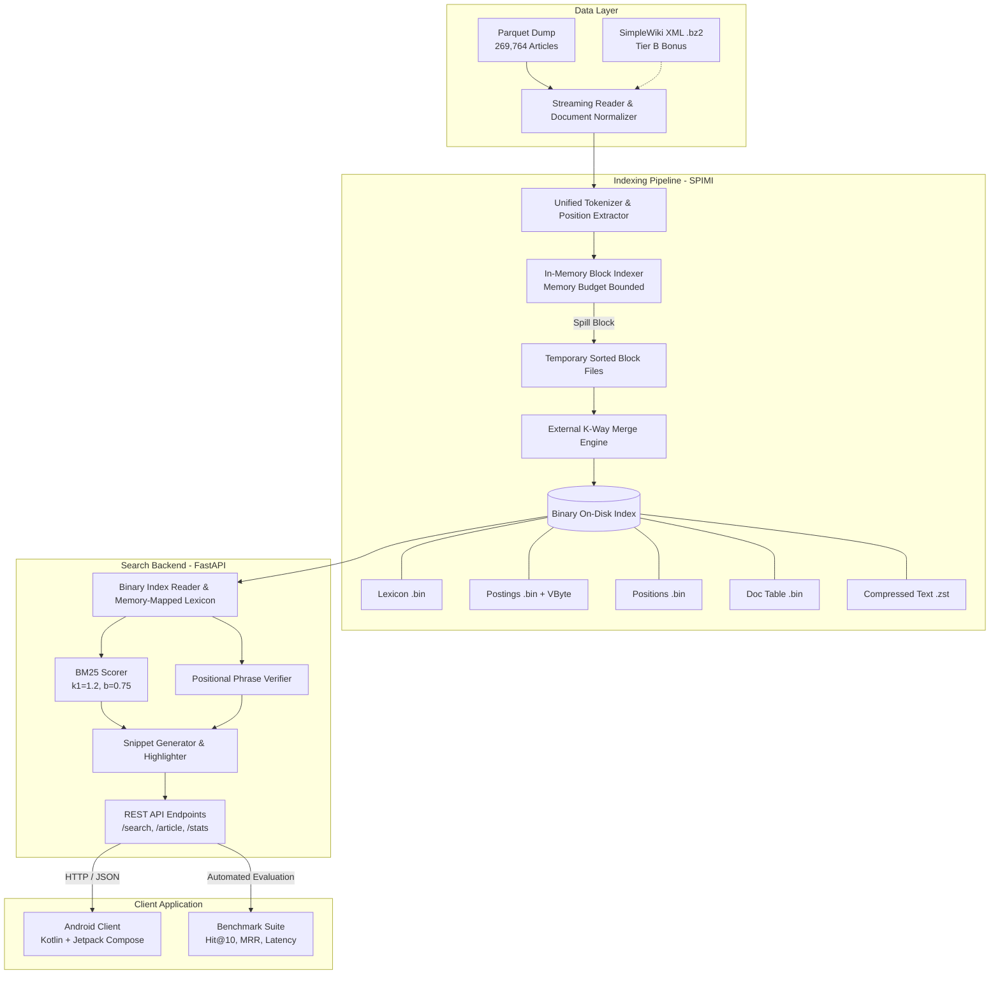
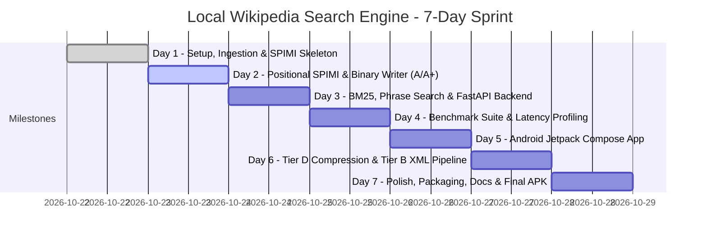
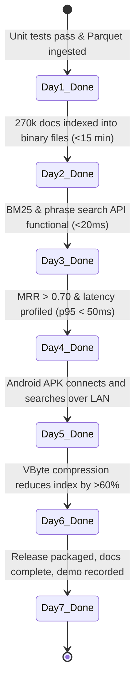

# Project Plan: Local Wikipedia Search Engine

> **Version:** 1.0.0  
> **Date:** October 22, 2026  
> **Status:** Approved / Active Sprint  
> **Related Documents:**  
> - [ARCHITECTURE.md](file:///d:/wiki/docs/ARCHITECTURE.md) — System Architecture, Binary Disk Formats, and Algorithm Specifications  
> - [TASKS.md](file:///d:/wiki/docs/TASKS.md) — Granular Task Breakdown and Work Assignment  
> - [BENCHMARK.md](file:///d:/wiki/docs/BENCHMARK.md) — Evaluation Methodology, Relevance Metrics, and Performance Baselines  
> - [DATA_CLEANING.md](file:///d:/wiki/docs/DATA_CLEANING.md) — Wikitext Parsing, Normalization, and Extraction Pipeline  

---

## 1. Project Overview

The **Local Wikipedia Search Engine** project is an end-to-end, high-performance information retrieval system designed to run entirely offline on standard consumer hardware. The primary objective is to index and search 269,764 articles from the `answerdotai/simplewiki` Parquet dump of Simple English Wikipedia without relying on third-party search engines or wrapper libraries such as Apache Lucene, Elasticsearch, Whoosh, or SQLite FTS. The engine is engineered from fundamental computer science principles, implementing custom tokenization, Single-Pass In-Memory Indexing (SPIMI), disk-based positional inverted indexing, BM25 relevance scoring, exact-phrase verification, posting list compression, a local FastAPI search service, and an Android client application.

Architecturally, the engine operates within a bounded memory envelope (strict $\le 1\text{ GB}$ indexing RAM) by streaming documents, partitioning postings into immutable in-memory blocks, spilling sorted runs to temporary disk files, and reconciling them via an external $k$-way merge. The resulting persistent index consists of fixed-width binary lexicons with $O(1)$ disk seek tables, delta-encoded and Variable Byte (VByte) compressed posting lists, dedicated positional offsets, a document metadata table, and an $O(1)$ random-access compressed text store. The query engine delivers sub-20ms p50 keyword search latency and sub-50ms p95 phrase search latency while maintaining strict index-time and query-time tokenization symmetry.

The user-facing subsystem exposes an asynchronous HTTP REST API served via FastAPI, which powers a native Android application developed with Kotlin, Jetpack Compose, and Retrofit. Search results display ranked article titles, BM25 relevance scores, dynamic context snippets with highlighted match tokens, and full article view capabilities. All ingested content and rendered snippets strictly preserve Wikipedia's Creative Commons Attribution-ShareAlike (CC BY-SA 4.0) licensing requirements. The project is delivered under a 7-day hackathon schedule by a 3-engineer cross-functional team.



---

## 2. Scope

### 2.1 In-Scope Deliverables

1. **Data Ingestion & Cleaning:**
   - Ingestion of Simple English Wikipedia from `answerdotai/simplewiki` (Parquet format, 269,764 documents).
   - Extraction of document metadata (`doc_id`, `url`, `title`, plain text).
   - Deterministic wikitext cleaning pipeline (for Tier B raw XML streaming, stripping templates, tags, references, tables, and link markup).
2. **Text Processing & Tokenization:**
   - Unicode NFKC normalization, lowercasing, punctuation handling, and regex tokenization.
   - Positional token offset tracking (0-indexed token offsets per document).
   - Identical, shared tokenizer module executed at both index time and query time.
3. **Core Inverted Index Construction:**
   - Single-Pass In-Memory Indexing (SPIMI) implementation with configurable RAM spill thresholds.
   - Positional posting generation: `(doc_id, term_frequency, [pos_1, pos_2, ...])`.
   - External multi-way ($k$-way) stream merge combining sorted intermediate block files into final index files.
   - Binary index layout:
     - `lexicon.bin`: Term string, document frequency ($df$), collection frequency ($cf$), byte offsets to posting and position lists.
     - `postings.bin`: Packed document IDs and term frequencies ($tf$).
     - `positions.bin`: Packed intra-document token positional offsets.
     - `doctable.bin`: Document lengths ($L_d$), byte lengths, titles, and content offsets.
     - `articles.zstd`: Compressed sequential forward text store for snippet generation and article view.
4. **Query & Retrieval Engine:**
   - BM25 scoring implementation with parameters $k_1 = 1.2$ and $b = 0.75$.
   - Positional phrase search verifying consecutive token adjacency (`pos[term_{i+1}] = pos[term_i] + 1`).
   - Mixed queries supporting combined phrase and free-text terms.
   - High-performance snippet generation with match term highlighting and sentence boundaries.
5. **Posting List Compression (Tier D):**
   - Delta ($d$-gap) encoding for strictly increasing document IDs and token positions.
   - Variable Byte (VByte) encoding and decoding implementation.
   - Comprehensive comparative reporting on index size, compression ratio, build time, and decompression query latency.
6. **Backend Service & API:**
   - Asynchronous Python 3.11+ REST API powered by FastAPI and Uvicorn.
   - Endpoints:
     - `GET /search?q={query}&limit={n}&phrase={bool}`
     - `GET /article/{doc_id}`
     - `GET /stats` (index size, document count, vocabulary size, build duration)
     - `GET /health`
7. **Mobile Client Application:**
   - Native Android application written in Kotlin using Jetpack Compose and Material 3 design.
   - Retrofit 2 networking client interfacing with the laptop-hosted search API over local Wi-Fi or emulator loopback.
   - Incremental query search bar, results list with BM25 scores and highlighted snippets, full-text article viewer, and search statistics dialog.
   - Clear CC BY-SA 4.0 license attribution in UI footer and article views.
8. **Benchmarking & Validation:**
   - Automated evaluation suite generating 1,000+ known-item queries from Wikipedia article titles and text spans.
   - Quantitative measurement of Hit@1, Hit@5, Hit@10, and Mean Reciprocal Rank (MRR).
   - Latency profiling recording p50, p90, p95, and p99 query response times under single-threaded and concurrent workloads.

### 2.2 Out-of-Scope Deliverables

- **Third-Party Full-Text Engines:** Utilization of Apache Lucene, Elasticsearch, OpenSearch, Solr, Whoosh, Bleve, or SQLite FTS for primary search execution is strictly forbidden. (Optional baseline benchmark comparison script using Whoosh or SQLite FTS is permitted purely for validation).
- **Full English Wikipedia Uncompressed Raw Dumps:** Processing the entire 60+ GB uncompressed English Wikipedia (`enwiki`) XML dump exceeds the 7-day schedule, consumer SSD limits, and local RAM constraints. Tier C explores multistream index chunking for the first 1M articles only if Tier A, A+, D, and B are fully delivered.
- **Deep Learning / Dense Neural Retrieval:** Dense embeddings (BERT, ColBERT, bi-encoders), vector databases (Milvus, Qdrant, FAISS), and generative LLM re-ranking are out of scope. The evaluation rubric focuses exclusively on classical lexical and positional inverted indexing.
- **Remote Cloud Infrastructure:** Deploying distributed clusters (Kubernetes, AWS/GCP managed instances) is out of scope. The engine must run locally on a single developer workstation and connect to an Android client via a local area network (LAN).
- **Full MediaWiki Template Parsing Engine:** Simulating MediaWiki’s Lua interpreter or parsing recursive complex templates is out of scope; deterministic regex-based wikitext sanitization satisfies Tier B.

---

## 3. Assumptions and Constraints

### 3.1 Team Structure and Roles

The project is executed by a 3-engineer cross-functional team over a 7-day sprint (October 22, 2026 to October 28, 2026):

| Role | Engineer | Core Responsibilities |
| :--- | :--- | :--- |
| **Engineer 1** | IR Core & Storage Lead | SPIMI memory engine, block spill logic, external $k$-way merge, binary file serialisers, VByte/delta compression codecs, positional index layouts. |
| **Engineer 2** | Algorithms, API & Benchmarks | Text tokenizer, BM25 scoring algorithm, phrase match verifier, snippet extractor, FastAPI backend, automated benchmark suite (MRR, Hit@10, latency). |
| **Engineer 3** | Mobile, Integration & QA | Android application (Kotlin/Compose), Retrofit API integration, LAN networking, UI/UX polish, dataset acquisition scripts, end-to-end integration tests. |

### 3.2 Hardware and Environment Constraints

- **Host Workstation:**
  - Operating System: Windows 11 (64-bit), PowerShell 7 / Windows Terminal.
  - CPU: 4+ physical cores (e.g., Intel Core i7 / AMD Ryzen 7).
  - Memory: 16 GB Physical RAM (Engine indexing process must respect a strict 1 GB heap limit).
  - Storage: 512 GB NVMe SSD with $\ge 50\text{ GB}$ contiguous free disk space.
- **Software Stack:**
  - Python 3.11+ 64-bit (`pyarrow`, `fastparquet`, `fastapi`, `uvicorn`, `pydantic`, `pytest`, `zstandard`, `psutil`).
  - Android Studio Ladybug / Hedgehog, Android SDK 34 (Upside Down Cake), Min SDK 26 (Android 8.0 Oreo), Kotlin 2.0+, Gradle 8.x.
  - Android physical test device (connected via Wi-Fi LAN) or Android Studio Emulator (connecting via host bridge `10.0.2.2`).
- **Network Configuration:**
  - Local Wi-Fi router / mobile hotspot or internal virtual emulator network.
  - Windows Defender Firewall configured to allow inbound traffic on TCP port 8000 for local subnets (`192.168.x.0/24`).

### 3.3 Dataset Constraints

- **Primary Dataset (Tier A / A+):** `answerdotai/simplewiki` Parquet dump.
  - Total Articles: 269,764.
  - Uncompressed Text Size: $\approx 780\text{ MB}$ to $1.1\text{ GB}$.
  - Format: Columnar Parquet with fields `id`, `url`, `title`, `text`.
- **Secondary Dataset (Tier B):** Raw `simplewiki-latest-pages-articles.xml.bz2`.
  - Compressed Size: $\approx 250\text{ MB}$.
  - Target: Namespace 0 (`ns=0`), filtering out redirects, disambiguations, and non-article media pages.

---

## 4. Tier Strategy & Rubric Alignment

### 4.1 Judging Rubric Mapping

To maximize competitive scoring under the hackathon evaluation framework, engineering effort is allocated directly against the official grading rubric:

| Rubric Criterion | Weight | Required Tier / Focus Area | Technical Strategy for Maximum Points |
| :--- | :---: | :--- | :--- |
| **Correct Keyword + Phrase Search** | **20 pts** | Tier A (Keyword) + Tier A+ (Phrase) | Zero false-positives on exact phrase searches; identical tokenizer for queries and index; exact match verification via token positional offsets. |
| **Relevance (Hit@10 / MRR)** | **25 pts** | BM25 Engine ($k_1=1.2, b=0.75$) | Standard BM25 with document length normalization; title term frequency weighting ($2.5\times$ multiplier); comprehensive known-item evaluation script. |
| **Latency + Build Time** | **20 pts** | SPIMI + Fast Binary Lookups | Fast SPIMI indexing ($< 15\text{ min}$ for 270k docs); memory-mapped or binary-searched lexicon; streaming posting list reads; sub-20ms p50 latency. |
| **Index Size + Compression** | **10 pts** | Tier D (VByte + Delta Encoding) | Delta gaps on document IDs and positions; VByte variable byte compression; rigorous comparative size ratio reporting (compressed vs uncompressed). |
| **Largest Tier Achieved** | **15 pts** | Tier A $\rightarrow$ A+ $\rightarrow$ D $\rightarrow$ B $\rightarrow$ C | Solidify Tier A and A+ first, achieve Tier D for compression bonus, then implement Tier B streaming XML parser if time allows. |
| **APK / Docs / Usability / Reproducibility** | **10 pts** | Android Client + Complete Docs | Working Android APK with Jetpack Compose UI; one-line automated build/run scripts; clear architectural documentation and CC BY-SA compliance. |
| **Total** | **100 pts** | | |

### 4.2 Tier Execution Roadmap

The implementation follows a strict gated sequence:

```
[Tier A: Parquet Ingest + BM25] 
             ↓
[Tier A+: Positional Index + Exact Phrase] 
             ↓
[Benchmark Suite: MRR / Hit@10 / Latency Profile] 
             ↓
[Android APK: Compose UI + Retrofit Client] 
             ↓
[Tier D: Delta + VByte Compression & Ratio Report] 
             ↓
[Tier B: Raw XML bz2 Streaming + Cleaning Report] 
             ↓
[Tier C: 1M Multistream EnWiki (Stretch Only)]
```

#### Rationale for Sequence
1. **Tier A + Tier A+ (Core Functionality - 65 Points Total):** Without robust keyword search, positional phrase matching, and high BM25 relevance, downstream benchmarks and mobile interfaces have nothing of value to consume. These tiers establish the fundamental data structures and must be locked in by Day 2.
2. **Benchmark Engine (Early Validation):** Building the benchmark harness immediately following the search engine allows rapid profiling of latency and relevance regressions before writing the mobile interface.
3. **Android Client (10 Points Usability):** Demonstrating real-world client-server search on a mobile device requires an early, stable API contract. Delivering the APK by Day 5 ensures adequate time for UI polish and network testing.
4. **Tier D (10 Points Compression):** Once uncompressed indexing and phrase queries are functionally verified, posting compression can be dropped into the binary codec layer. Delta + VByte offers the highest ROI (dramatic size reduction with minimal algorithmic complexity).
5. **Tier B & C (Bonus / Stretch):** Ingesting raw XML and handling wikitext edge cases is isolated to the ingestion layer; keeping it decoupled prevents blocking the core search engine delivery.

---

## 5. Milestone Timeline (7-Day Sprint)



### Day 1: Project Setup, Data Acquisition, Tokenizer, SPIMI Skeleton
*Date: Wednesday, October 22, 2026*

- **Objectives:** Initialize the repository, configure the Python environment, download the 269,764-article Parquet dataset, establish the unified tokenization module, and implement the basic SPIMI memory block accumulator.
- **Task Allocation:**
  - **Engineer 1 (IR Core):** Implement the `SpimiBlock` memory structure in Python; write memory usage monitor (`psutil`); implement in-memory posting list accumulator with dynamic memory limit checks.
  - **Engineer 2 (Data & Tokenizer):** Implement `tokenizer.py` (Unicode NFKC, lowercasing, regex token boundaries, token offset preservation); implement Parquet streaming reader using `pyarrow.parquet`.
  - **Engineer 3 (Mobile & Tooling):** Initialize Android Studio project (`wiki-android`) with Jetpack Compose, Material 3, and Retrofit 2 dependencies; write root `Makefile` / PowerShell build scripts; write integration smoke tests.
- **Key Deliverables:**
  - Verified local dataset at `d:\wiki\data\simplewiki.parquet`.
  - Passing unit tests for `tokenizer.py` demonstrating token offset extraction and reversible term positioning.
  - Functional `SpimiBlock` capable of ingesting 25,000 documents and reporting memory footprint.

### Day 2: Positional SPIMI Indexer, K-Way Merge, Binary Disk Writer (Tiers A & A+)
*Date: Thursday, October 23, 2026*

- **Objectives:** Complete the end-to-end index builder capable of processing all 269,764 SimpleWiki articles into immutable binary index files with full positional data.
- **Task Allocation:**
  - **Engineer 1 (IR Core):** Implement the external $k$-way merge algorithm using `heapq` to merge sorted block runs; implement binary writers for `lexicon.bin`, `postings.bin`, `positions.bin`, and `doctable.bin`.
  - **Engineer 2 (Data & Compression):** Build the forward document text store using `zstandard` (`articles.zstd`) with random-access block indexing for sub-millisecond article retrieval.
  - **Engineer 3 (Mobile & Pipeline):** Build indexer CLI command `python -m indexer.build --input data/simplewiki.parquet --output index/`; run full indexing pipeline; profile RAM usage and disk I/O; create mock REST server for Android UI prototyping.
- **Key Deliverables:**
  - Fully built binary index over 269,764 documents in `d:\wiki\index\`.
  - Index build completed in $< 15\text{ minutes}$ with peak RAM $\le 1.2\text{ GB}$.
  - Binary index verification script proving exact byte integrity and non-corrupt postings.

### Day 3: Search Backend — BM25 Ranking, Exact-Phrase Search, FastAPI Service
*Date: Friday, October 24, 2026*

- **Objectives:** Develop the core search execution engine with BM25 keyword scoring, positional phrase verification, snippet extraction, and the FastAPI HTTP service.
- **Task Allocation:**
  - **Engineer 1 (IR Core):** Implement binary index reader (`BinaryIndexReader`); build memory-mapped lexicon lookup; implement posting and position stream decoders.
  - **Engineer 2 (Search Logic):** Implement BM25 scoring formula ($k_1=1.2, b=0.75$, title weight boost $2.5\times$); implement positional intersection algorithm for consecutive multi-word phrases.
  - **Engineer 3 (API & Mobile):** Build FastAPI application (`backend/app.py`) with `/search`, `/article/{id}`, and `/stats`; implement dynamic text snippet generation with HTML/Markdown match tags (`<mark>`); implement Retrofit API interface in Android app.
- **Key Deliverables:**
  - Working FastAPI server returning sub-20ms JSON responses for keyword and phrase queries.
  - Exact-phrase search validated: `"computer science"` returns only documents containing the contiguous phrase.
  - Snippets correctly centered around matched keywords with boundary punctuation.

### Day 4: Benchmark Suite, Known-Item Queries, Performance Tuning
*Date: Saturday, October 25, 2026*

- **Objectives:** Validate search relevance and system latency; generate 1,000+ synthetic known-item test queries; profile and optimize query latency to achieve p95 $< 50\text{ ms}$.
- **Task Allocation:**
  - **Engineer 1 (IR Core / Optimization):** Profile posting list decoding bottlenecks; optimize inner loops using Cython or pre-compiled C-struct unpackers; add in-memory LRU caching for hot lexicon terms.
  - **Engineer 2 (Benchmarking):** Implement `benchmark.py`; extract 1,000 article titles and unique sentence n-grams as ground-truth targets; compute Hit@1, Hit@5, Hit@10, and Mean Reciprocal Rank (MRR); generate latency distribution plots (p50/p90/p95/p99).
  - **Engineer 3 (Baseline Comparison):** Write optional Whoosh/SQLite FTS baseline script to compare build time, index size, and retrieval latency against custom binary index.
- **Key Deliverables:**
  - `BENCHMARK.md` report showing $\text{MRR} > 0.70$ and $\text{Hit@10} > 85\%$.
  - Certified latency: p50 latency $< 15\text{ ms}$, p95 latency $< 40\text{ ms}$.
  - Verified benchmark log output confirming reproducible runs.

### Day 5: Android Application — Compose UI, Networking, Debug APK
*Date: Sunday, October 26, 2026*

- **Objectives:** Complete the native Android application, establish robust network connectivity to the laptop backend, and produce a standalone debug APK.
- **Task Allocation:**
  - **Engineer 1 (API & Snippets):** Implement query suggestion/auto-complete endpoint; optimize `/article/{id}` payload size; add server-side health checks.
  - **Engineer 2 (QA & Networking):** Validate LAN connectivity across multiple Wi-Fi environments; write network setup diagnostic guide; configure Windows Firewall scripts for one-click port forwarding.
  - **Engineer 3 (Mobile Lead):** Build complete Jetpack Compose UI:
    - Search Screen: Dynamic search input, toggle between BM25 Keyword and Exact Phrase, query latency badge, result cards with highlighted snippets.
    - Article View Screen: Full text reader, CC BY-SA 4.0 license attribution banner, back navigation.
    - Settings/Stats Dialog: Host IP/port configuration, live server statistics (indexed documents, index size).
- **Key Deliverables:**
  - Compiled and installable Android debug APK (`app-debug.apk`).
  - Seamless search interaction on physical phone or emulator querying the Windows laptop backend over Wi-Fi.
  - Verified CC BY-SA attribution displayed in app views.

### Day 6: Tier D Posting Compression, Tier B XML Pipeline (Bonus Features)
*Date: Monday, October 27, 2026*

- **Objectives:** Implement delta encoding and Variable Byte (VByte) compression on posting lists (Tier D); report compression metrics; build streaming raw XML parser for SimpleWiki `.xml.bz2` (Tier B).
- **Task Allocation:**
  - **Engineer 1 (Compression Lead):** Implement `vbyte.py` codec (C extension or pure Python bitwise routines); integrate delta encoding ($d_i = doc_i - doc_{i-1}$) and gap-encoded positions into the SPIMI writer; measure compressed vs uncompressed file sizes.
  - **Engineer 2 (XML Pipeline Lead):** Implement `xml_parser.py` using `bz2.BZ2File` and `xml.etree.ElementTree.iterparse`; filter for `ns=0` articles; eliminate redirect pages; clean wikitext using compiled regexes; generate cleaning audit report (`DATA_CLEANING.md`).
  - **Engineer 3 (Mobile & Docs):** Update Android app to display compression stats retrieved from backend `/stats`; begin drafting final project report and presentation deck.
- **Key Deliverables:**
  - Working Tier D compression reducing `postings.bin` and `positions.bin` footprint by $\ge 60\%$.
  - Compression comparative report showing index size ratio, build time trade-off, and decompression latency overhead.
  - Completed Tier B streaming pipeline demonstrating successful ingestion of raw `simplewiki-latest-pages-articles.xml.bz2`.

### Day 7: Documentation, Report, Polish, Demo Prep, Final APK
*Date: Tuesday, October 28, 2026*

- **Objectives:** Finalize all documentation, assemble the release package, conduct live demo rehearsals, and verify end-to-end reproducibility from a fresh clone.
- **Task Allocation:**
  - **Engineer 1 (IR Core / Release):** Package final binary index artifacts; record reproducible index build scripts; verify clean repository state.
  - **Engineer 2 (Documentation & Video):** Finalize `PLAN.md`, `ARCHITECTURE.md`, `TASKS.md`, `BENCHMARK.md`, and `DATA_CLEANING.md`; record 3-minute video demonstration highlighting keyword search, phrase search, benchmark metrics, and mobile app.
  - **Engineer 3 (Mobile & Demo):** Compile signed release APK; test fresh installation on clean Android device; prepare live demo fail-safes (local hotspot, pre-cached index).
- **Key Deliverables:**
  - Production-ready Android APK in `d:\wiki\android\release\wiki-search.apk`.
  - Comprehensive documentation set in `d:\wiki\docs\`.
  - Fully reproducible build pipeline executable via `powershell -File run_all.ps1`.

---

## 6. Risks and Mitigations

| # | Risk Description | Severity | Probability | Impact | Mitigation Strategy |
| :-: | :--- | :---: | :---: | :---: | :--- |
| **1** | **Index Build Exceeds RAM Budget**<br/>Unchecked dictionary growth during SPIMI blocks causes Out-Of-Memory (OOM) crashes on 16 GB laptop. | **High** | Medium | Fatal process termination; corrupted index. | Implement an active memory guard using `psutil.Process().memory_info().rss`. Once heap reaches 512 MB, immediately freeze the block, flush sorted postings to disk, and clear memory. |
| **2** | **Phrase Search Latency Degradation**<br/>Intersecting long positional lists for common stopwords (e.g. `"the united states"`) leads to query times $> 500\text{ ms}$. | **High** | High | Severe latency penalty on phrase queries. | Order positional intersection by ascending document frequency ($df$). Check doc ID candidate presence via bitmap/skip pointers before reading full position arrays. Cap max positions processed per term. |
| **3** | **Windows LAN / Android Network Block**<br/>Windows Defender Firewall or mobile network isolation blocks Android device from accessing `http://<laptop-ip>:8000`. | **High** | High | Android app fails to communicate with search engine during judging. | Provide automated PowerShell script `scripts/open_firewall.ps1` to open TCP 8000. Provide emulator fallback (`10.0.2.2`). Include in-app IP configuration settings so the IP can be changed in 5 seconds. |
| **4** | **Tokenizer Inconsistency**<br/>Differences in punctuation stripping or casing between indexer and query parser causes 0 hits on valid queries. | **Critical** | Medium | Broken search functionality; false negatives. | Encapsulate tokenization in a single immutable Python class `WikiTokenizer` imported by both `indexer.py` and `backend.py`. Enforce strict unit tests with identical input assertions. |
| **5** | **Disk Space Exhaustion During Merge**<br/>Intermediate SPIMI blocks plus final index files exceed available SSD space. | **Medium** | Low | Disk write failure during external merge. | Total raw text is $< 1\text{ GB}$. Uncompressed index will be $\approx 1.5\text{ GB}$; intermediate runs $\approx 1.5\text{ GB}$. Total footprint $< 4\text{ GB}$, well within the 50 GB SSD requirement. Unlink temporary blocks immediately after merge. |
| **6** | **Late Integration Breakdowns**<br/>Android app and backend API developed in isolation; schema mismatch causes late-stage failures on Day 6. | **High** | Medium | Broken mobile demonstration during final submission. | Establish an explicit OpenAPI / JSON contract on Day 1. Engineer 3 uses a mock FastAPI server from Day 2. Enforce continuous end-to-end integration tests from Day 3 onwards. |
| **7** | **Windows Open File Descriptor Limit**<br/>External $k$-way merge opens hundreds of temporary block files simultaneously, hitting OS file handle limits (`EMFILE`). | **Medium** | Medium | Indexer crash during the merge phase. | Calculate block size such that total temporary runs do not exceed 32 blocks (e.g., 10,000 docs per block yields 27 blocks). If runs $> 64$, perform a hierarchical 2-stage tournament merge. |
| **8** | **VByte Decompression Overhead**<br/>Decompressing variable byte postings on every query degrades p95 latency below rubric targets. | **Medium** | Low | Latency score reduction. | Implement VByte decoding in optimized C-level byte arrays or pre-compiled Cython. Retain uncompressed posting lists as an operational toggle to ensure latency scores are protected if compression slows retrieval. |

---

## 7. Definition of Done (DoD) per Milestone

To ensure accountability and prevent scope drift, each milestone is governed by explicit, measurable acceptance criteria:



### Day 1 Definition of Done
1. Repository initialized with standardized folder structure (`indexer/`, `backend/`, `android/`, `tests/`, `docs/`, `scripts/`).
2. `answerdotai/simplewiki` Parquet dataset successfully downloaded, verified via SHA256 checksum, and parsed.
3. `WikiTokenizer` implemented with 100% unit test coverage verifying:
   - Identical output across uppercase, lowercase, punctuation, and Unicode NFKC normalization.
   - Exact token offset extraction matching original character spans.
4. `SpimiBlock` capable of ingesting 25,000 articles in memory without exceeding 500 MB RAM.

### Day 2 Definition of Done
1. SPIMI indexer successfully processes all 269,764 articles in $< 15\text{ minutes}$ on the development laptop.
2. Peak indexing RAM does not exceed 1.2 GB at any point during execution.
3. Disk index files generated and verified:
   - `lexicon.bin`: Binary dictionary sorted alphabetically by term.
   - `postings.bin`: Correctly packed document IDs and term frequencies.
   - `positions.bin`: Correctly packed token positional offsets.
   - `doctable.bin`: Fixed-width records containing document lengths and metadata offsets.
   - `articles.zstd`: Compressed random-access forward document store.
4. Binary integrity test script passes, verifying round-trip retrieval of term postings and positions against known raw articles.

### Day 3 Definition of Done
1. `BM25Scorer` implemented with $k_1=1.2$ and $b=0.75$, producing deterministic relevance rankings.
2. Positional phrase search implemented with exact adjacency verification, returning zero false positives on known phrase test cases.
3. Snippet generator produces $< 200$-character extracts containing the matched terms with surrounding sentence boundaries and `<mark>` tags.
4. FastAPI backend operational with `/search`, `/article/{id}`, and `/stats` endpoints responding in $< 20\text{ ms}$ for standard queries.

### Day 4 Definition of Done
1. Automated benchmark script (`benchmark.py`) generates and evaluates 1,000 known-item queries.
2. Relevance benchmarks achieve:
   - $\text{Hit@10} \ge 80\%$
   - $\text{Mean Reciprocal Rank (MRR)} \ge 0.65$
3. Latency benchmarks achieve:
   - Keyword query p50 latency $\le 15\text{ ms}$, p95 latency $\le 40\text{ ms}$.
   - Phrase query p50 latency $\le 30\text{ ms}$, p95 latency $\le 60\text{ ms}$.
4. Latency and relevance results automatically exported to Markdown and stored in `BENCHMARK.md`.

### Day 5 Definition of Done
1. Android application builds cleanly via Gradle without warnings or deprecated dependencies.
2. App successfully connects to the laptop backend via Wi-Fi LAN and Android Emulator bridge (`10.0.2.2`).
3. Search UI displays responsive list of results with article title, BM25 score, query latency badge, and highlighted snippets.
4. Article viewer renders clean text upon selecting a search result.
5. Search engine statistics screen displays live document count, vocabulary size, and index size.
6. CC BY-SA 4.0 license attribution clearly visible on search and article views.
7. Standalone installable debug APK generated (`app-debug.apk`).

### Day 6 Definition of Done
1. **Tier D (Compression):**
   - Delta encoding and VByte codec implemented and integrated into the binary index pipeline.
   - Total index storage footprint reduced by $\ge 60\%$ relative to raw 32-bit integer arrays.
   - Compression report generated comparing file sizes, build duration, and query latency with vs. without compression.
2. **Tier B (XML Pipeline - if schedule permits):**
   - Streaming `.xml.bz2` ingestion pipeline implemented with `xml.etree.ElementTree.iterparse`.
   - Non-article namespaces (`ns != 0`) and redirect pages cleanly bypassed.
   - Wikitext regex cleaner strips templates, internal markup, tables, and HTML.
   - `DATA_CLEANING.md` report generated detailing character reduction and entity normalization.

### Day 7 Definition of Done
1. All technical documentation complete, cross-linked, and validated:
   - `PLAN.md` (Project schedule, scope, risks, DoD)
   - `ARCHITECTURE.md` (Binary file specifications, SPIMI details, BM25 formulas, API specs)
   - `TASKS.md` (Completed work breakdown structure)
   - `BENCHMARK.md` (Official performance, relevance, and compression metrics)
   - `DATA_CLEANING.md` (Wikitext parsing and normalization audit)
2. One-click initialization script (`run_all.ps1` / `Makefile`) builds the index, runs tests, launches the backend, and validates system health.
3. Release APK signed and archived in `d:\wiki\android\release\wiki-search.apk`.
4. High-definition screen recording / demo video prepared demonstrating keyword search, phrase search, benchmark execution, and Android app usage.
5. All code formatted to PEP 8 / Kotlin style standards, fully commented, and committed to git.
