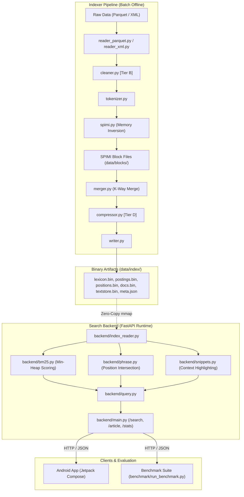

# Repository Structure & Component Architecture

This document defines the folder and file layout for the **Local Wikipedia Search Engine**, detailing the responsibilities of each directory, file, and sub-module. It establishes clear **separation of concerns** across ingestion, offline indexing, online query serving, client presentation, and benchmarking.

---

## 1. Directory Tree Overview

```text
d:\wiki\
├── README.md                    # Setup instructions, usage guide, demo steps
├── requirements.txt             # Python dependencies (pinned versions)
├── .gitignore                   # Ignore data/, *.pyc, __pycache__, .venv, *.apk, etc.
│
├── indexer/                     # Index building pipeline
│   ├── __init__.py              # Package init
│   ├── tokenizer.py             # Shared tokenizer (lowercase, regex split, positions)
│   ├── reader_parquet.py        # Parquet dataset reader (answerdotai/simplewiki)
│   ├── reader_xml.py            # [Tier B] XML dump reader (streaming bz2+iterparse)
│   ├── cleaner.py               # [Tier B] Wikitext cleaning pipeline
│   ├── spimi.py                 # SPIMI block builder (in-memory accumulation + flush)
│   ├── merger.py                # K-way merge of SPIMI block files
│   ├── writer.py                # Binary file writer (lexicon, postings, positions, docs, titles, textstore)
│   ├── compressor.py            # [Tier D] Delta + VByte posting list compression
│   └── build.py                 # Main entry point: orchestrates the full index build
│
├── backend/                     # Search HTTP API server
│   ├── __init__.py              # Package init
│   ├── index_reader.py          # Loads lexicon, mmaps postings/positions, reads docs table
│   ├── bm25.py                  # BM25 scoring with top-k min-heap
│   ├── phrase.py                # Phrase matching via position intersection
│   ├── snippets.py              # Snippet extraction and query term highlighting
│   ├── query.py                 # Query parsing (tokenization, mode dispatch)
│   └── main.py                  # FastAPI app with /search, /article/{id}, /stats endpoints
│
├── android/                     # Android app
│   └── WikiSearch/              # Android Studio project root
│       ├── app/
│       │   └── src/main/
│       │       ├── java/com/wikisearch/
│       │       │   ├── MainActivity.kt
│       │       │   ├── ui/
│       │       │   │   ├── SearchScreen.kt
│       │       │   │   ├── ResultsScreen.kt  (or combined with SearchScreen)
│       │       │   │   └── ArticleScreen.kt
│       │       │   ├── data/
│       │       │   │   ├── ApiService.kt      # Retrofit interface
│       │       │   │   └── Models.kt          # Data classes
│       │       │   └── viewmodel/
│       │       │       └── SearchViewModel.kt
│       │       ├── res/
│       │       │   └── xml/
│       │       │       └── network_security_config.xml
│       │       └── AndroidManifest.xml
│       ├── build.gradle.kts
│       └── gradle/
│
├── benchmark/                   # Benchmarking suite
│   ├── generate_queries.py      # Generates known-item query set from titles/text
│   ├── run_benchmark.py         # Runs queries, measures latency, computes metrics
│   ├── queries.json             # Generated query set (output of generate_queries.py)
│   └── results/                 # Benchmark output directory
│       ├── results.csv          # Raw per-query results
│       └── summary.json         # Aggregated metrics
│
├── data/                        # Data directory (gitignored)
│   ├── raw/                     # Downloaded datasets
│   │   └── simplewiki/          # Parquet files from HuggingFace
│   ├── index/                   # Built index files
│   │   ├── meta.json
│   │   ├── lexicon.bin
│   │   ├── lexicon_index.bin
│   │   ├── postings.bin
│   │   ├── positions.bin
│   │   ├── docs.bin
│   │   ├── titles.bin
│   │   └── textstore.bin
│   └── blocks/                  # Temporary SPIMI blocks (cleaned after merge)
│
├── docs/                        # Project documentation
│   ├── PLAN.md                  # Project plan, scope, timeline, risks
│   ├── ARCHITECTURE.md          # Technical architecture, file formats, algorithms
│   ├── TASKS.md                 # Task checklist with estimates and dependencies
│   ├── REPO_STRUCTURE.md        # This file
│   ├── BENCHMARK_PLAN.md        # Benchmark methodology and metrics
│   └── REPORT_OUTLINE.md        # One-page report skeleton
│
├── scripts/                     # Utility scripts
│   ├── download_data.py         # Downloads Parquet dataset from HuggingFace
│   └── run_all.sh               # End-to-end: download, build index, start server
│
└── report/                      # Final deliverables
    ├── report.md                # One-page report with measured metrics
    └── cleaning_report.md       # [Tier B] Wikitext cleaning statistics
```

---

## 2. Architectural Separation of Concerns

The architecture strictly decouples **offline batch indexing**, **immutable binary index storage**, **stateless low-latency API serving**, **native user interface presentation**, and **empirical benchmark evaluation**.



### Key Separation Principles
1. **Zero Runtime Coupling Between Indexer and Backend**: The backend contains no dependencies on index generation logic or temporary SPIMI buffers. The only interface between them is the immutable binary file format specified in `data/index/`.
2. **Deterministic Tokenization Symmetry**: [`indexer/tokenizer.py`](file:///d:/wiki/indexer/tokenizer.py) is shared between index creation and query parsing to prevent lexical mismatch bugs (e.g., differential casing, punctuation stripping, or Unicode normalization).
3. **Stateless API Runtime**: [`backend/main.py`](file:///d:/wiki/backend/main.py) maintains read-only zero-copy memory maps (`mmap`) to postings and document tables, allowing concurrency without locks or IPC overhead.
4. **Independent Benchmark Harness**: [`benchmark/`](file:///d:/wiki/benchmark/) operates as an external client measuring cold, warm, and end-to-end performance without instrumenting backend production paths with debug overhead.

---

## 3. Detailed Component Breakdown

### 3.1 Root Files

* [`README.md`](file:///d:/wiki/README.md)
  Contains comprehensive setup instructions, prerequisites, step-by-step commands to download data, build the index, launch the backend, and run the Android app or benchmark suite. It serves as the primary operational entry point for users and evaluators.
* [`requirements.txt`](file:///d:/wiki/requirements.txt)
  Specifies exact, pinned Python package versions (such as `fastapi`, `uvicorn`, `pyarrow`, `pandas`, `requests`, `numpy`, and `pytest`) to ensure reproducible builds across development and testing environments.
* [`.gitignore`](file:///d:/wiki/.gitignore)
  Prevents tracking generated binary index artifacts (`data/index/*.bin`), raw corpus dumps (`data/raw/`), temporary merge blocks (`data/blocks/`), Python bytecode (`__pycache__/`, `*.pyc`), virtual environments (`.venv/`), and Android build outputs (`*.apk`, `.gradle/`).

---

### 3.2 Indexer Pipeline (`indexer/`)

The indexer is responsible for ingesting Wikipedia text, tokenizing documents, constructing inverted index postings using Single-Pass In-Memory Indexing (SPIMI), and serializing compacted binary files.

* [`indexer/__init__.py`](file:///d:/wiki/indexer/__init__.py)
  Declares the `indexer` folder as an importable Python package and exposes top-level pipeline configurations.
* [`indexer/tokenizer.py`](file:///d:/wiki/indexer/tokenizer.py)
  Implements the unified lexical analyzer that transforms raw document text and search queries into normalized token streams. Outputs token strings alongside word-offset positions required for positional phrase indexing.
* [`indexer/reader_parquet.py`](file:///d:/wiki/indexer/reader_parquet.py)
  Streams articles efficiently from Apache Parquet files (`answerdotai/simplewiki`) in chunks without loading the entire dataset into memory. Yields normalized document tuples containing document ID, Wikipedia URL/slug, title, and body text.
* [`indexer/reader_xml.py`](file:///d:/wiki/indexer/reader_xml.py) *(Tier B)*
  Implements a streaming XML reader for official Wikipedia dump archives (`.xml.bz2`) using `bz2.BZ2File` and `xml.etree.ElementTree.iterparse`. Avoids out-of-memory errors by discarding processed XML element trees immediately after extraction.
* [`indexer/cleaner.py`](file:///d:/wiki/indexer/cleaner.py) *(Tier B)*
  A high-speed wikitext sanitization pipeline that strips templates, infoboxes, media links, HTML tags, and wiki markup while preserving clean paragraph prose and section headers. Emits cleaning statistics such as compression ratio and unhandled markup counts.
* [`indexer/spimi.py`](file:///d:/wiki/indexer/spimi.py)
  Implements the Single-Pass In-Memory Indexing (SPIMI-Invert) core. Accumulates dictionary tokens, document IDs, term frequencies, and positional offsets into RAM until a predetermined memory threshold (e.g., 512 MB) is reached, then flushes a sorted intermediate block to disk.
* [`indexer/merger.py`](file:///d:/wiki/indexer/merger.py)
  Performs an external multi-way merge ($K$-way merge using a min-heap) across sorted SPIMI block files. Emits unified, term-sorted postings lists and positional indexes without exceeding memory limits.
* [`indexer/writer.py`](file:///d:/wiki/indexer/writer.py)
  Writes the final contiguous binary data structures (`lexicon.bin`, `lexicon_index.bin`, `postings.bin`, `positions.bin`, `docs.bin`, `titles.bin`, `textstore.bin`, `meta.json`). Handles binary packing (`struct.pack`) using fixed-width little-endian byte layouts.
* [`indexer/compressor.py`](file:///d:/wiki/indexer/compressor.py) *(Tier D)*
  Provides integer list compression using document delta encoding ($d_i - d_{i-1}$) paired with Variable Byte (VByte) or SIMD-BP128 encoding. Reduces raw posting list storage footprint on disk and reduces I/O transfer time during queries.
* [`indexer/build.py`](file:///d:/wiki/indexer/build.py)
  The CLI orchestrator for index generation. Accepts source arguments (parquet vs. xml), controls memory limits, runs the extraction, invokes SPIMI blocks, merges blocks, compiles binary assets, and outputs build metrics.

---

### 3.3 Search Backend (`backend/`)

The backend is an asynchronous, high-performance web service providing BM25 ranking, positional phrase queries, document retrieval, and snippet generation.

* [`backend/__init__.py`](file:///d:/wiki/backend/__init__.py)
  Marks the directory as a Python package and configures backend runtime constants.
* [`backend/index_reader.py`](file:///d:/wiki/backend/index_reader.py)
  Loads `lexicon.bin` into memory, provides $O(\log M)$ binary search or two-level index lookup (`lexicon_index.bin`), memory-maps (`mmap`) `postings.bin` and `positions.bin`, and provides fast slice-based retrieval for document metadata.
* [`backend/bm25.py`](file:///d:/wiki/backend/bm25.py)
  Computes Okapi BM25 scores for candidate documents against query terms using an IDF cache and accumulator map. Employs a bounded min-heap (`heapq`) of size $k$ to track top-scoring documents efficiently without sorting the full candidate set.
* [`backend/phrase.py`](file:///d:/wiki/backend/phrase.py)
  Performs exact phrase matching using positional posting list intersection. Verifies that consecutive query terms appear in target documents at offsets $pos(t_{i+1}) = pos(t_i) + 1$.
* [`backend/snippets.py`](file:///d:/wiki/backend/snippets.py)
  Extracts relevant text snippets (150–250 characters) centered around query term hit locations retrieved from `textstore.bin`. Wraps matched query terms in HTML/Markdown highlight tags (`<mark>...</mark>`) for client display.
* [`backend/query.py`](file:///d:/wiki/backend/query.py)
  Parses user query strings, detects query intent (exact quoted phrase vs. unquoted disjunctive/conjunctive keyword search), normalizes tokens using [`indexer/tokenizer.py`](file:///d:/wiki/indexer/tokenizer.py), and dispatches to BM25 or phrase evaluation pipelines.
* [`backend/main.py`](file:///d:/wiki/backend/main.py)
  The FastAPI application entry point. Implements REST endpoints: `GET /search` (query, mode, limit, offset), `GET /article/{id}` (full text and metadata), and `GET /stats` (corpus size, term count, index footprint, uptime).

---

### 3.4 Android Client (`android/WikiSearch/`)

A native Android application written in Kotlin and Jetpack Compose that connects to the backend over HTTP/REST to deliver an interactive search experience.

* [`android/WikiSearch/build.gradle.kts`](file:///d:/wiki/android/WikiSearch/build.gradle.kts)
  Root and module Gradle build configurations specifying Kotlin versions, Jetpack Compose compiler dependencies, Retrofit/Moshi networking libraries, and Android SDK targets (minSdk 26, targetSdk 34).
* [`android/WikiSearch/app/src/main/AndroidManifest.xml`](file:///d:/wiki/android/WikiSearch/app/src/main/AndroidManifest.xml)
  Declares application permissions (`android.permission.INTERNET`, `android.permission.ACCESS_NETWORK_STATE`), registers activities, and links the network security configuration for local development.
* [`android/WikiSearch/app/src/main/res/xml/network_security_config.xml`](file:///d:/wiki/android/WikiSearch/app/src/main/res/xml/network_security_config.xml)
  Permits cleartext HTTP communication (`usesCleartextTraffic`) targeting local development hosts (`10.0.2.2` for the Android Emulator or local Wi-Fi IP ranges for physical hardware).
* [`android/WikiSearch/app/src/main/java/com/wikisearch/MainActivity.kt`](file:///d:/wiki/android/WikiSearch/app/src/main/java/com/wikisearch/MainActivity.kt)
  The single host activity initializing Compose Navigation and passing application-scoped dependencies to screen composables.
* [`android/WikiSearch/app/src/main/java/com/wikisearch/ui/SearchScreen.kt`](file:///d:/wiki/android/WikiSearch/app/src/main/java/com/wikisearch/ui/SearchScreen.kt)
  The primary user interface containing the search bar, mode selector toggle (Keyword BM25 vs. Exact Phrase), search history suggestions, and loading indicators.
* [`android/WikiSearch/app/src/main/java/com/wikisearch/ui/ResultsScreen.kt`](file:///d:/wiki/android/WikiSearch/app/src/main/java/com/wikisearch/ui/ResultsScreen.kt)
  Renders the list of ranked search results in a lazy column, displaying article titles, BM25 score badges, highlighted text snippets, and document length.
* [`android/WikiSearch/app/src/main/java/com/wikisearch/ui/ArticleScreen.kt`](file:///d:/wiki/android/WikiSearch/app/src/main/java/com/wikisearch/ui/ArticleScreen.kt)
  Displays the full text of an article retrieved by ID, supporting in-page search term highlighting, section browsing, and quick back-navigation.
* [`android/WikiSearch/app/src/main/java/com/wikisearch/data/ApiService.kt`](file:///d:/wiki/android/WikiSearch/app/src/main/java/com/wikisearch/data/ApiService.kt)
  Retrofit interface defining asynchronous HTTP contracts for `/search`, `/article/{id}`, and `/stats`.
* [`android/WikiSearch/app/src/main/java/com/wikisearch/data/Models.kt`](file:///d:/wiki/android/WikiSearch/app/src/main/java/com/wikisearch/data/Models.kt)
  Kotlin `@Serializable` data classes modeling API request parameters and JSON responses (`SearchResponse`, `SearchResultItem`, `ArticleDetail`, `EngineStats`).
* [`android/WikiSearch/app/src/main/java/com/wikisearch/viewmodel/SearchViewModel.kt`](file:///d:/wiki/android/WikiSearch/app/src/main/java/com/wikisearch/viewmodel/SearchViewModel.kt)
  Android Architecture ViewModel managing UI state flows (`StateFlow`), executing debounced search calls via coroutines, handling network error states, and tracking active queries.

---

### 3.5 Benchmark Suite (`benchmark/`)

Automated harness to evaluate ranking effectiveness, response latency, and system resource consumption under standardized workloads.

* [`benchmark/generate_queries.py`](file:///d:/wiki/benchmark/generate_queries.py)
  Extracts ground-truth evaluation queries from index files or corpus text. Generates a balanced set of exact title queries (known-item retrieval), multi-token body phrases (positional index verification), and general keyword searches.
* [`benchmark/run_benchmark.py`](file:///d:/wiki/benchmark/run_benchmark.py)
  Executes queries against the running server or backend engine directly. Measures cold vs. warm query latencies, computes Hit@10 and Mean Reciprocal Rank (MRR), aggregates percentiles ($p50$, $p95$, $p99$), and outputs summary logs.
* [`benchmark/queries.json`](file:///d:/wiki/benchmark/queries.json)
  Persisted collection of 100+ benchmark queries annotated with query ID, query string, search mode, expected document ID, and expected title.
* [`benchmark/results/results.csv`](file:///d:/wiki/benchmark/results/results.csv)
  Raw per-query benchmark records containing execution timestamp, query ID, mode, engine latency, client latency, retrieved doc IDs, hit status, and reciprocal rank.
* [`benchmark/results/summary.json`](file:///d:/wiki/benchmark/results/summary.json)
  Aggregated statistical report containing overall Hit@10, MRR, latency distributions ($p50$, $p90$, $p95$, $p99$), index build duration, and index storage efficiency metrics.

---

### 3.6 Data Directory (`data/`)

Dedicated workspace for storage of external corpus downloads, temporary merge intermediates, and final binary index structures. This directory is excluded from version control via `.gitignore`.

* [`data/raw/simplewiki/`](file:///d:/wiki/data/raw/simplewiki/)
  Contains downloaded Apache Parquet files containing articles from Simple English Wikipedia.
* [`data/blocks/`](file:///d:/wiki/data/blocks/)
  Holds temporary intermediate index runs flushed by [`indexer/spimi.py`](file:///d:/wiki/indexer/spimi.py). Automatically pruned once [`indexer/merger.py`](file:///d:/wiki/indexer/merger.py) completes the final pass.
* [`data/index/meta.json`](file:///d:/wiki/data/index/meta.json)
  Human-readable JSON document storing global corpus metadata: total document count ($N$), total indexed tokens, average document length ($avgdl$), vocabulary size, index schema version, and timestamp.
* [`data/index/lexicon.bin`](file:///d:/wiki/data/index/lexicon.bin)
  Binary vocabulary table containing sorted terms, document frequencies ($df$), collection term frequencies ($cf$), and byte offsets into `postings.bin` and `positions.bin`.
* [`data/index/lexicon_index.bin`](file:///d:/wiki/data/index/lexicon_index.bin)
  Sparse secondary index holding every $k$-th lexicon term to allow sub-millisecond prefix seeks and fast binary search over large vocabularies.
* [`data/index/postings.bin`](file:///d:/wiki/data/index/postings.bin)
  Sequential inverted lists storing pairs of document ID and term frequency `(doc_id, tf)` either uncompressed or compressed using VByte/Delta coding.
* [`data/index/positions.bin`](file:///d:/wiki/data/index/positions.bin)
  Positional postings file storing token word-offsets within documents, enabling exact phrase queries and distance searches.
* [`data/index/docs.bin`](file:///d:/wiki/data/index/docs.bin)
  Fixed-width record table indexing each internal document ID to its document length ($|D|$), title offset, and textstore byte offset.
* [`data/index/titles.bin`](file:///d:/wiki/data/index/titles.bin)
  Length-prefixed UTF-8 encoded article title strings for instant title resolution.
* [`data/index/textstore.bin`](file:///d:/wiki/data/index/textstore.bin)
  Compressed or raw article text store indexed by byte offsets for rapid snippet generation and full article display.

---

### 3.7 Documentation (`docs/`)

Engineering blueprints, specifications, implementation task trackers, and analysis plans.

* [`docs/PLAN.md`](file:///d:/wiki/docs/PLAN.md)
  High-level project roadmap, system requirements, tier definitions (Tier A through Tier D), development milestones, schedule, and risk management matrix.
* [`docs/ARCHITECTURE.md`](file:///d:/wiki/docs/ARCHITECTURE.md)
  Deep technical specification detailing binary byte layouts, struct packing alignments, SPIMI streaming algorithms, BM25 mathematical optimizations, and phrase intersection logic.
* [`docs/TASKS.md`](file:///d:/wiki/docs/TASKS.md)
  Granular engineering task checklist broken down by component with time estimates, dependencies, acceptance criteria, and completion checkboxes.
* [`docs/REPO_STRUCTURE.md`](file:///d:/wiki/docs/REPO_STRUCTURE.md)
  This document; structural index and separation of concerns catalog.
* [`docs/BENCHMARK_PLAN.md`](file:///d:/wiki/docs/BENCHMARK_PLAN.md)
  Benchmark evaluation methodology detailing query generation categories, statistical metric definitions, test procedures, and reporting targets.
* [`docs/REPORT_OUTLINE.md`](file:///d:/wiki/docs/REPORT_OUTLINE.md)
  Standardized one-page final summary template for recording system build times, index size ratios, latency percentiles, and BM25 evaluation scores.

---

### 3.8 Utility Scripts (`scripts/`)

Operational scripts for automated environment setup, dataset acquisition, and orchestration.

* [`scripts/download_data.py`](file:///d:/wiki/scripts/download_data.py)
  Automates the download of Simple English Wikipedia datasets from Hugging Face (`answerdotai/simplewiki`) using standard HTTP streaming, placing files into `data/raw/simplewiki/`.
* [`scripts/run_all.sh`](file:///d:/wiki/scripts/run_all.sh)
  End-to-end Bash/PowerShell runner script that verifies prerequisites, downloads raw data if missing, runs the index builder, launches the FastAPI server, and executes the benchmark suite.

---

### 3.9 Final Deliverables (`report/`)

Final evaluation artifacts summarizing project findings and benchmark verification.

* [`report/report.md`](file:///d:/wiki/report/report.md)
  The completed one-page technical report populated with measured experimental results, metrics tables, tier completion statuses, and future roadmap items.
* [`report/cleaning_report.md`](file:///d:/wiki/report/cleaning_report.md) *(Tier B)*
  Empirical statistics from the Wikitext cleaning pipeline, detailing byte reduction ratios, template removal counts, markup artifacts encountered, and cleaning throughput.
