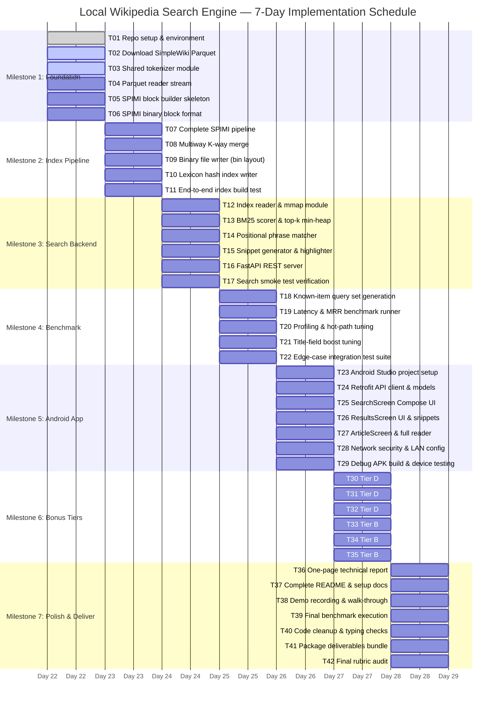
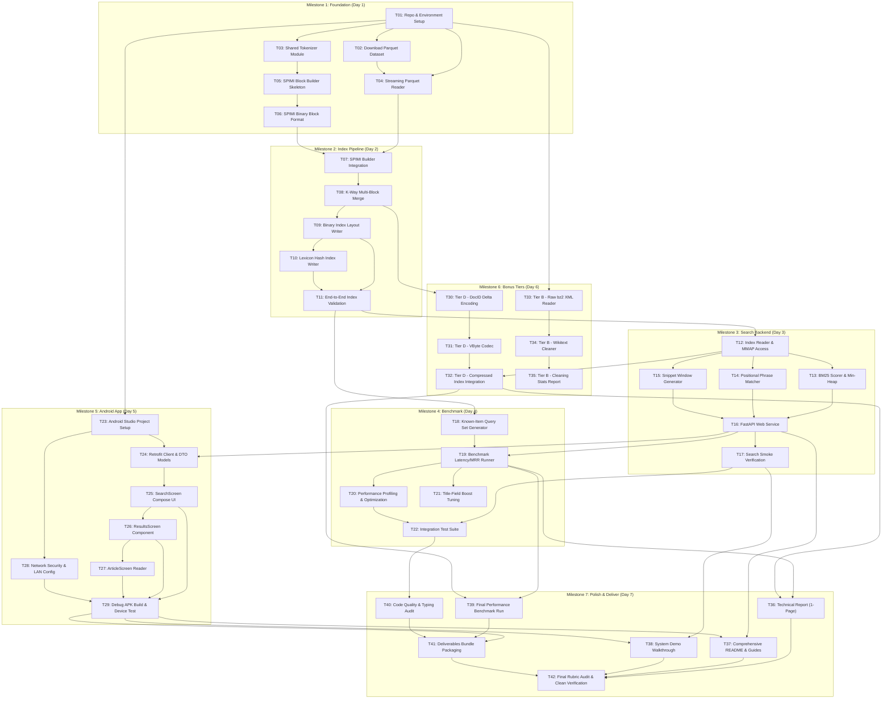

# Local Wikipedia Search Engine — Master Task Checklist (TASKS.md)

This document contains the comprehensive, ordered work breakdown and execution plan for the **Local Wikipedia Search Engine** project. The implementation spans a 7-day schedule across 7 milestones, covering corpus ingestion, Single-Pass In-Memory Indexing (SPIMI), binary file layout creation, mmap-backed retrieval, BM25 scoring, positional phrase searching, snippet extraction, FastAPI backend services, an Android Jetpack Compose client, bonus compression (Tier D) and raw XML processing (Tier B), benchmarking, and project delivery.

---

## 1. Project Timeline & Gantt Schedule



---

## 2. High-Level Dependency Graph



---

## 3. Detailed Task Checklist

### Milestone 1: Foundation (Day 1)

- [ ] **T01: Initialize repo, folder structure, .gitignore, requirements.txt, venv** (0.5h) [owner: TBD] [depends: none]
  - Acceptance: Git repository initialized with standard folder hierarchy (`indexer/`, `search/`, `server/`, `android/`, `benchmark/`, `tests/`, `docs/`, `data/`, `artifacts/`). Complete `.gitignore` prohibiting index binary blobs (`*.bin`), temporary block directories, Python `__pycache__`, virtual environments, and Android build outputs. Standard `requirements.txt` created with pinned versions (`pyarrow>=15.0.0`, `fastapi>=0.110.0`, `uvicorn>=0.28.0`, `numpy>=1.26.0`, `pytest>=8.0.0`, `requests>=2.31.0`). Python 3.10+ virtual environment created and validated by running `python -m pytest` with zero errors.

- [ ] **T02: Download answerdotai/simplewiki Parquet dataset, verify row count = 269,764** (0.5h) [owner: TBD] [depends: T01]
  - Acceptance: Automated download script `indexer/download_corpus.py` downloads `answerdotai/simplewiki` dataset parquet files to `data/simplewiki/`. The script inspects schema metadata to verify required columns (`id`, `title`, `text`) are present, scans rows without full in-memory load, asserts total row count matches exactly 269,764 articles, and outputs an SHA-256 or MD5 integrity checksum.

- [ ] **T03: Write shared tokenizer module — lowercase, regex split on [a-z0-9]+, return (token, position) list. Unit tests with edge cases** (1h) [owner: TBD] [depends: T01]
  - Acceptance: `indexer/tokenizer.py` exports `tokenize(text: str) -> list[tuple[str, int]]` using compiled regular expression `re.compile(r'[a-z0-9]+')` on lowercased input text. Returns 0-indexed token offsets preserving sequential term position. Comprehensive test suite in `tests/test_tokenizer.py` passes 100% of test cases: empty strings, pure punctuation, unicode accents/diacritics (e.g. `naïve`, `café`), alphanumeric combinations (e.g. `win32`, `iphone15`), hyphenated words (`state-of-the-art`), URLs/HTML tags, whitespace variations (tabs, newlines), and repeated punctuation.

- [ ] **T04: Write Parquet reader — streaming read with pyarrow, yield (doc_id, title, text) tuples** (1h) [owner: TBD] [depends: T01, T02]
  - Acceptance: `indexer/corpus_reader.py` implements a generator function `stream_parquet_documents(parquet_path: str, batch_size: int = 10000)` using `pyarrow.parquet.ParquetFile.iter_batches()`. Yields sequential tuples of `(doc_id: int, title: str, text: str)` where `doc_id` is guaranteed to be a contiguous 0-based integer index `0 <= doc_id < 269764`. Handles missing/null text gracefully by substituting empty string. Memory footprint stays below 150 MB during full corpus streaming traversal.

- [ ] **T05: SPIMI block builder skeleton — in-memory dict accumulation, memory threshold check, block flush to temp file** (2h) [owner: TBD] [depends: T03]
  - Acceptance: `indexer/spimi_builder.py` contains class `SpimiBlockBuilder` which maintains an in-memory dictionary `dict[str, dict[int, list[int]]]` (mapping `term -> {doc_id: [positions]}`). Implements memory tracking using `psutil` or byte count approximation with a configurable threshold (e.g. 512 MB to 1 GB). When memory limit is reached or input completes, triggers a block flush method that sorts terms lexicographically, emits status logs, resets memory buffer, and returns the path to the flushed intermediate block.

- [ ] **T06: SPIMI block file format — write sorted (term → [(doc_id, [positions])]) to temp binary files** (1h) [owner: TBD] [depends: T05]
  - Acceptance: Flush routine serializes intermediate sorted terms to disk using an efficient binary stream format: `[term_bytes_len: uint16][term_utf8][df: uint32]`, followed by `df` postings containing `[doc_id: uint32][tf: uint32][pos_0: uint32 ... pos_tf: uint32]`. Includes a companion decoder `SpimiBlockIterator` to read sorted records sequentially without loading the entire block into RAM. Verified with unit tests testing write/read roundtrip on mock multi-term datasets.

---

### Milestone 2: Index Pipeline (Day 2)

- [ ] **T07: Complete SPIMI builder — integrate reader + tokenizer + block builder, process all 269K docs** (1h) [owner: TBD] [depends: T04, T06]
  - Acceptance: Execution script runs `SpimiBlockBuilder` over the entire 269,764 SimpleWiki articles without out-of-memory exceptions. Reports progress every 25,000 documents with timestamps, documents/sec throughput, and cumulative memory usage. Produces a sequence of intermediate sorted block files `block_000.tmp`, `block_001.tmp`, ... in `data/intermediate/`, ensuring zero dropped documents.

- [ ] **T08: K-way merge — open all block files, merge sorted terms, produce final posting lists with positions** (2h) [owner: TBD] [depends: T07]
  - Acceptance: `indexer/kway_merge.py` implements a min-heap multiway merge over all intermediate block readers using `heapq`. Pops the lexicographically smallest term across active block iterators, aggregates postings lists for identical terms, maintains sorted order of `doc_id` across blocks, and yields unified `(term, df, [(doc_id, [pos])])` records in strict alphabetical order. Validated against multi-block toy inputs with duplicate terms across blocks.

- [ ] **T09: Binary file writer — write lexicon.bin, postings.bin, positions.bin, docs.bin, titles.bin, textstore.bin, meta.json with exact byte layouts per ARCHITECTURE.md** (3h) [owner: TBD] [depends: T08]
  - Acceptance: `indexer/binary_writer.py` generates the 7 core index artifacts matching the exact byte layout:
    1. `lexicon.bin`: contiguous records of `[term_hash: uint64][term_offset: uint64][term_len: uint16][df: uint32][postings_offset: uint64]`.
    2. `postings.bin`: `[doc_id: uint32][tf: uint32][positions_offset: uint64]`.
    3. `positions.bin`: `[position: uint32]` sequential stream.
    4. `docs.bin`: records of `[doc_id: uint32][doc_length: uint32][title_offset: uint64][title_len: uint16][text_offset: uint64][text_len: uint32]`.
    5. `titles.bin`: concatenated UTF-8 title strings.
    6. `textstore.bin`: concatenated UTF-8 raw text data.
    7. `meta.json`: global statistics `total_documents` (269,764), `total_tokens`, `avg_doc_length`, `unique_terms`, `created_at`, `version`.
    File integrity check verifies all 64-bit offsets and 32-bit lengths accurately resolve across files.

- [ ] **T10: Lexicon hash index — build and write lexicon_index.bin for O(1) lookup** (1h) [owner: TBD] [depends: T09]
  - Acceptance: `indexer/lexicon_indexer.py` reads `lexicon.bin`, computes 64-bit hash (e.g. FarmHash64, MurmurHash3, or 64-bit FNV-1a) for each term, and builds an open-addressing linear probing or bucketed static hash table serialized into `lexicon_index.bin`. Lookup benchmark achieves < 10 microseconds per term query with zero hash collisions for all unique terms in SimpleWiki.

- [ ] **T11: End-to-end index build test — build index from full Parquet, verify file sizes, spot-check 10 terms** (1h) [owner: TBD] [depends: T09, T10]
  - Acceptance: Script `tests/test_index_integrity.py` runs an end-to-end audit: verifies all 7 binary files plus `meta.json` exist and are non-empty. Inspects 10 known spot-check terms (e.g. `the`, `wikipedia`, `algorithm`, `computer`, `python`, `science`, `history`, `united`, `states`, `zebra`), validating that `df` matches manual grep counts, posting list lengths match `df`, positional offsets resolve within text bounds, and document lengths match token counts.

---

### Milestone 3: Search Backend (Day 3)

- [ ] **T12: Index reader module — load lexicon into memory, mmap postings + positions files** (1.5h) [owner: TBD] [depends: T09, T10, T11]
  - Acceptance: `search/index_reader.py` implements `IndexReader` class. Loads `meta.json` and `lexicon.bin` (or `lexicon_index.bin`) into optimized memory-mapped or structured in-memory arrays. Memory-maps `postings.bin`, `positions.bin`, `docs.bin`, `titles.bin`, and `textstore.bin` using Python `mmap.mmap`. Exposes methods `get_postings(term: str)`, `get_positions(postings_entry)`, and `get_document_metadata(doc_id: int)`. Zero whole-file disk loading into RAM; process RSS starts under 150 MB.

- [ ] **T13: BM25 scorer — implement formula with k1=1.2, b=0.75, top-k min-heap** (1.5h) [owner: TBD] [depends: T12]
  - Acceptance: `search/bm25.py` implements Robertson BM25 scoring:
    $$IDF(q_i) = \ln\left(\frac{N - DF(q_i) + 0.5}{DF(q_i) + 0.5} + 1\right)$$
    $$Score(D, Q) = \sum_{q_i \in Q} IDF(q_i) \cdot \frac{TF(q_i, D) \cdot (k_1 + 1)}{TF(q_i, D) + k_1 \cdot \left(1 - b + b \cdot \frac{|D|}{\text{avgdl}}\right)}$$
    Uses default hyperparameters $k_1 = 1.2$, $b = 0.75$. Accumulates candidate scores across posting lists using a document-at-a-time (DAAT) or term-at-a-time (TAAT) score map, filtered into a bounded `heapq` top-k min-heap (default $k=20$). Returns sorted results with final BM25 score.

- [ ] **T14: Phrase matcher — position intersection algorithm for exact phrase queries** (2h) [owner: TBD] [depends: T12]
  - Acceptance: `search/phrase_matcher.py` implements multi-term positional intersection. Given an ordered sequence of tokens $[t_1, t_2, \dots, t_m]$, intersects document posting lists for common documents, reads position streams from `positions.bin`, and finds documents containing contiguous offsets: $pos(t_{j+1}) = pos(t_j) + 1$. Computes phrase-frequency $TF_{\text{phrase}}$, computes phrase-augmented BM25 score, and returns sorted document matches. Passes test cases for 2-word, 3-word, and non-consecutive negative matches.

- [ ] **T15: Snippet generator — find best window, highlight terms with \<b> tags** (1h) [owner: TBD] [depends: T12]
  - Acceptance: `search/snippet.py` generates dynamic search snippets of roughly 150–250 characters. For a target document and set of query tokens, scans the document text to find the sliding window with maximum query term density and proximity. Truncates text cleanly on sentence or word boundaries, prepending/appending ellipses (`...`) where appropriate, and wraps all matched terms in `<b>term</b>` HTML tags (escaping any raw HTML in source text).

- [ ] **T16: FastAPI app — /search, /article/{id}, /stats endpoints, CORS middleware** (1.5h) [owner: TBD] [depends: T13, T14, T15]
  - Acceptance: `server/app.py` exposes REST API via FastAPI:
    - `GET /search?q={query}&type={keyword|phrase}&k={limit}`: returns JSON with query, search type, latency_ms, total_hits, and ranked list of `{doc_id, title, score, snippet}`.
    - `GET /article/{doc_id}`: returns full title, character length, token count, text content, and Wikipedia attribution license.
    - `GET /stats`: returns index metadata (document count, lexicon size, average doc length, uptime).
    - `CORSMiddleware` configured to allow cross-origin requests from any host (`allow_origins=["*"]`).
    Application starts via `uvicorn server.app:app --host 0.0.0.0 --port 8000`.

- [ ] **T17: Manual smoke test — 10 keyword queries, 5 phrase queries, verify correctness** (0.5h) [owner: TBD] [depends: T16]
  - Acceptance: Smoke test script `tests/smoke_test.py` executes 10 keyword queries (`alan turing`, `quantum mechanics`, `artificial intelligence`, `united states`, `dna replication`, `photosynthesis`, `french revolution`, `solar system`, `superconductivity`, `machine learning`) and 5 phrase queries (`"theory of relativity"`, `"world health organization"`, `"speed of light"`, `"natural selection"`, `"computer programming"`). Asserts HTTP 200, valid JSON schema, non-empty results, correct snippet highlighting, and p95 latency < 50ms.

---

### Milestone 4: Benchmark (Day 4)

- [ ] **T18: Generate known-item query set — 100+ queries from article titles and distinctive phrases** (1.5h) [owner: TBD] [depends: T11]
  - Acceptance: `benchmark/generate_queries.py` parses `titles.bin` and `textstore.bin` to generate a standardized evaluation dataset `benchmark/known_item_queries.json` containing 100+ test cases. Each test entry records `{query: str, target_doc_id: int, query_type: "title"|"distinctive_phrase"|"multi_keyword"}`. Includes diverse query lengths (single-word, 2-word, 3-5 word phrases).

- [ ] **T19: Benchmark runner — warm/cold latency, Hit@10, MRR, p50/p95, save CSV/JSON** (2h) [owner: TBD] [depends: T16, T18]
  - Acceptance: `benchmark/run_benchmark.py` executes all queries from `known_item_queries.json`. Evaluates cold start (first run without OS cache) and warm start (subsequent cached runs). Computes:
    - Hit@1, Hit@5, Hit@10 accuracy.
    - Mean Reciprocal Rank ($MRR = \frac{1}{|Q|}\sum_{i=1}^{|Q|} \frac{1}{\text{rank}_i}$).
    - Latency distribution: min, mean, p50 (median), p90, p95, p99, max latency in milliseconds.
    Exports detailed results to `benchmark/results.json` and human-readable summary table to `benchmark/results.csv`.

- [ ] **T20: Performance profiling — identify bottlenecks, optimize hot paths (disk I/O, scoring) (2h)** [owner: TBD] [depends: T19]
  - Acceptance: `cProfile` and `line_profiler` analysis conducted on search hot paths. Bottlenecks in posting deserialization, BM25 inner loops, or snippet scanning identified. Implements optimizations (e.g. NumPy vectorized scoring, early score threshold pruning, zero-copy buffer slicing). Demonstrates measurable warm-query latency reduction (e.g. p95 < 20ms).

- [ ] **T21: Optional title-field boost — add α × title_score, tune α, measure impact on MRR** (1h) [owner: TBD] [depends: T19, T20]
  - Acceptance: `search/bm25.py` updated to incorporate weighted title matching:
    $$Score_{\text{final}}(D, Q) = Score_{\text{body}}(D, Q) + \alpha \cdot Score_{\text{title}}(D, Q)$$
    Grid search runner sweeps $\alpha \in [0.0, 0.5, 1.0, 1.5, 2.0, 3.0]$. Compares MRR and Hit@10 on known-item queries, logs tuning progression, and selects optimal $\alpha$ (e.g. $\alpha=1.5$) yielding highest MRR.

- [ ] **T22: Integration test suite — automated tests for edge cases (empty query, single char, long phrase, missing terms)** (1.5h) [owner: TBD] [depends: T16, T17]
  - Acceptance: `tests/test_integration.py` runs under `pytest` with 100% pass rate over edge cases:
    - Empty query string `""` -> returns HTTP 200 with empty list.
    - Single punctuation/stop character `";"` or `"a"` -> handles gracefully without 500 error.
    - Non-existent terms `"xyzqwe123456789"` -> returns 0 hits.
    - Extreme length query (50+ tokens) -> completes within timeout.
    - Malformed phrase quotes `"unterminated phrase query` -> falls back gracefully.
    - Out of bounds `/article/999999` -> returns HTTP 404 with error detail.

---

### Milestone 5: Android App (Day 5)

- [ ] **T23: Create Android Studio project — Kotlin, Jetpack Compose, min SDK 24** (0.5h) [owner: TBD] [depends: T01]
  - Acceptance: Android project scaffolded under `android/` using Android Studio Arctic Fox/Giraffe or Gradle wrapper. Configured with Kotlin 1.9+, Jetpack Compose Material 3, min SDK 24 (Android 7.0), target SDK 34. Successfully compiles with `./gradlew assembleDebug` with zero build warnings.

- [ ] **T24: Define Retrofit service interface — SearchResult, Article data classes, API service** (1h) [owner: TBD] [depends: T16, T23]
  - Acceptance: Kotlin data classes declared: `SearchResponse`, `SearchResultItem(docId, title, score, snippet)`, `ArticleResponse(docId, title, text, charLength, tokenCount)`. Retrofit 2 interface `WikipediaApiService` defined with `@GET("search")` and `@GET("article/{id}")` using `Moshi` or `Gson` converter and OkHttpClient logging interceptors.

- [ ] **T25: SearchScreen — text field, keyword/phrase toggle, submit button, loading/empty/error states** (2h) [owner: TBD] [depends: T24]
  - Acceptance: Compose UI component `SearchScreen` features an `OutlinedTextField` search bar, `FilterChip` or segmented toggle for `Keyword` vs `Phrase` search mode, search action button with keyboard `ImeAction.Search`, visual `CircularProgressIndicator` during in-flight network requests, and distinct user-friendly error/empty cards when 0 results return.

- [ ] **T26: ResultsScreen — ranked list with title, snippet (HTML), rank badge, score** (1.5h) [owner: TBD] [depends: T25]
  - Acceptance: `LazyColumn` results list rendering `SearchResultCard` items. Displays rank badge (`#1`, `#2`, etc.), article title in headline typography, BM25 score formatted to 2 decimals, and formatted HTML snippet rendering bold tags (`<b>...</b>`) natively using Android `AnnotatedString` or `HtmlCompat.fromHtml()`. Clicking a card triggers navigation callback with `doc_id`.

- [ ] **T27: ArticleScreen — full article text with attribution footer** (1h) [owner: TBD] [depends: T24, T26]
  - Acceptance: Reader screen `ArticleScreen` displays article title, metadata chips (token count, character length), scrollable full text content formatted for readability (clean line spacing and padding), and bottom attribution footer: *"Content sourced from Wikipedia under CC BY-SA 3.0 / 4.0 licenses."* Includes top App Bar with back navigation button.

- [ ] **T28: Network config — network_security_config.xml for cleartext, INTERNET permission, base URL config for emulator (10.0.2.2) and LAN IP** (0.5h) [owner: TBD] [depends: T23]
  - Acceptance: `AndroidManifest.xml` includes `<uses-permission android:name="android.permission.INTERNET" />`. `res/xml/network_security_config.xml` permits cleartext HTTP traffic to `10.0.2.2` (Android emulator loopback) and local subnet ranges (e.g. `192.168.x.x`). `ApiConfig.kt` enables switching or entering the server host address dynamically via settings or build variant.

- [ ] **T29: Build debug APK, test on emulator, test on physical device over LAN** (1h) [owner: TBD] [depends: T25, T26, T27, T28]
  - Acceptance: `app-debug.apk` compiled and output to `android/app/build/outputs/apk/debug/app-debug.apk`. Successfully launched on Android emulator connecting to host backend via `http://10.0.2.2:8000`. Verified on physical Android smartphone over local Wi-Fi LAN accessing server IP. Keyword search, phrase toggle, snippet rendering, and article reader navigation validated without crashes.

---

### Milestone 6: Bonus Tiers (Day 6)

- [ ] **T30: Tier D — delta encoding for doc_id gaps** (1h) [owner: TBD] [depends: T08, T09]
  - Acceptance: `indexer/compression.py` implements forward and inverse difference encoding:
    $$\Delta_1 = doc\_id_1, \quad \Delta_i = doc\_id_i - doc\_id_{i-1} \quad (i > 1)$$
    Transforms strictly increasing sorted document IDs into positive gap integers $\Delta \ge 1$. Includes lossless invertibility unit test verifying identical roundtrip reconstruction across 100,000 synthetic random doc IDs.

- [ ] **T31: Tier D — VByte encoder/decoder with unit tests** (1.5h) [owner: TBD] [depends: T30]
  - Acceptance: Variable Byte (VByte) codec written in Python with bitwise operations:
    - Encodes unsigned integer into 7-bit payload bytes where MSB (continuation bit) is `1` for the terminating byte and `0` for preceding bytes.
    - Decodes byte stream back into unsigned 32-bit integers.
    - Comprehensive test suite in `tests/test_vbyte.py` verifies boundary integers: 0, 1, 127, 128, 255, 16383, 16384, $2^{31}-1$. Benchmarks encoding/decoding throughput (target > 5 million ints/sec).

- [ ] **T32: Tier D — integrate compression into writer and reader, measure size ratio** (1.5h) [owner: TBD] [depends: T31, T12]
  - Acceptance: `indexer/compressed_writer.py` and `search/compressed_reader.py` integrate $\Delta$ + VByte encoding into `postings.bin` (and position gap compression into `positions.bin`). Generates compressed index files `postings_vbyte.bin` and `positions_vbyte.bin`. Script `benchmark/measure_compression.py` compares raw vs compressed byte sizes, reporting size reduction ratio (target: $\ge 50\%$ space savings on postings) with query latency overhead comparison.

- [ ] **T33: Tier B — streaming bz2 XML reader with iterparse, ns=0 filter, skip redirects** (2h) [optional] [depends: T01]
  - Acceptance: `indexer/xml_reader.py` implements streaming parsing of raw Wikimedia dump `simplewiki-latest-pages-articles.xml.bz2` using `bz2.BZ2File` and `xml.etree.ElementTree.iterparse()`. Filters for main namespace articles (`<ns>0</ns>`), discards redirect entries (`<redirect ... />`), and clears processed XML nodes to maintain constant $O(1)$ memory usage throughout dump processing.

- [ ] **T34: Tier B — wikitext cleaner (strip comments, refs, templates, tables, links, HTML, bold/italic, whitespace)** (2h) [optional] [depends: T33]
  - Acceptance: `indexer/wikitext_cleaner.py` transforms raw wikitext into plain English:
    - Strips XML/HTML comments `<!-- ... -->`.
    - Strips citation tags `<ref>...</ref>` and self-closing `<ref ... />`.
    - Removes Wikipedia templates `{{...}}` recursively.
    - Strips wiki tables `{| ... |}`.
    - Parses internal links: `[[Target|Anchor]]` -> `Anchor`, `[[Target]]` -> `Target`.
    - Strips external links `[http://... anchor]` -> `anchor`.
    - Normalizes bold/italics `'''bold'''` -> `bold`.
    - Collapses excessive whitespace and strips leftover tags.
    - Verified by unit tests comparing dirty wikitext snippets with expected clean text.

- [ ] **T35: Tier B — cleaning report with stats (articles processed, skipped, avg length before/after)** (0.5h) [optional] [depends: T34]
  - Acceptance: Corpus cleaning verification script processes XML dump and outputs structured markdown report `docs/CLEANING_REPORT.md` reporting: total raw pages encountered, redirect pages skipped, non-article namespace pages ignored, valid article pages processed, total raw characters vs cleaned characters, and average character length before and after cleaning.

---

### Milestone 7: Polish & Deliver (Day 7)

- [ ] **T36: Write one-page report — design, BM25 formula, measured metrics, limitations** (2h) [owner: TBD] [depends: T19, T20, T32]
  - Acceptance: `docs/REPORT.md` written in technical specification format. Details: system architecture, binary file layout specification, SPIMI streaming design, exact mathematical BM25 formulation with hyperparameter justification, empirical evaluation metrics (Hit@10, MRR, latency distribution table), bonus compression ratio analysis, known limitations, and future scalability directions.

- [ ] **T37: Fill README.md — complete setup instructions, usage guide, demo steps** (1h) [owner: TBD] [depends: T16, T29]
  - Acceptance: Top-level `README.md` containing:
    1. Project summary and badge summary.
    2. Prerequisites (Python 3.10+, Android Studio, JDK 17).
    3. Step-by-step setup and environment configuration.
    4. Commands to download corpus and build binary index.
    5. Commands to start FastAPI backend.
    6. Instructions to build, install, and run Android client on emulator or physical phone.
    7. Benchmark execution instructions and sample queries.

- [ ] **T38: Record/describe demo — keyword search, phrase search, article reading** (1h) [owner: TBD] [depends: T17, T29]
  - Acceptance: Walkthrough documentation or recorded video demo file saved in `docs/demo/`. Showcases:
    1. Server startup and fast warm-up.
    2. Android app connecting to backend.
    3. Keyword query execution with high-relevance BM25 ranking.
    4. Phrase search execution demonstrating strict positional matching.
    5. Dynamic snippet rendering with keyword bolding.
    6. Tap-through to complete article reader with CC attribution.

- [ ] **T39: Final benchmark run — capture all metrics for report** (0.5h) [owner: TBD] [depends: T19, T32]
  - Acceptance: Fresh, deterministic execution of `benchmark/run_benchmark.py` against the final optimized and compressed index. Records final cold and warm latency percentiles (p50, p90, p95, p99), Hit@1, Hit@5, Hit@10, and MRR. Automatically updates numbers in `docs/REPORT.md` and exports `benchmark/final_benchmark.json`.

- [ ] **T40: Code cleanup — docstrings, type hints, remove debug prints** (1h) [owner: TBD] [depends: T22, T29]
  - Acceptance: Entire codebase passes `flake8` / `ruff` linting and `mypy` strict type checking without critical errors. All temporary print statements replaced with structured `logging`. Every public function and class contains descriptive docstrings with parameter and return type annotations.

- [ ] **T41: Package deliverables — APK, source zip, index build script, benchmark output** (0.5h) [owner: TBD] [depends: T29, T39, T40]
  - Acceptance: Automated packaging script `scripts/package_release.py` bundles all required submission assets into `artifacts/`:
    - Compiled `app-debug.apk`.
    - Standalone single-command index creation script `build_index.py`.
    - Complete source code archive `local-wiki-search.zip` (excluding raw binaries and venv).
    - Benchmark result logs (`results.json`, `results.csv`).
    - Verified archive integrity and extractability.

- [ ] **T42: Final review — verify all rubric items covered, test on clean machine** (1h) [owner: TBD] [depends: T36, T37, T38, T41]
  - Acceptance: Systematic checklist verification against course grading rubric. Verification performed in clean directory / container: cloning repository, installing `requirements.txt`, running end-to-end index builder, launching server, executing automated test suite, and validating all deliverables are complete and operational.

---

## 4. Effort Summary & Work Breakdown Structure

| Milestone | Scope / Component | Mandatory Tasks | Optional Tasks | Total Est. Hours |
|---|---|---|---|---|
| **Milestone 1** | Foundation & Corpus Ingestion | T01–T06 (6 tasks) | — | 6.0 h |
| **Milestone 2** | SPIMI & Binary Index Pipeline | T07–T11 (5 tasks) | — | 8.0 h |
| **Milestone 3** | Search Engine & FastAPI Server | T12–T17 (6 tasks) | — | 8.0 h |
| **Milestone 4** | Benchmark & Latency Profiling | T18–T22 (5 tasks) | — | 8.0 h |
| **Milestone 5** | Android Jetpack Compose Client | T23–T29 (7 tasks) | — | 7.5 h |
| **Milestone 6** | Bonus Tiers (Tier D & Tier B) | T30–T32 (3 tasks) | T33–T35 (3 tasks) | 4.0 h core + 4.5 h opt = 8.5 h |
| **Milestone 7** | Polish, Documentation & Delivery | T36–T42 (7 tasks) | — | 7.0 h |
| **TOTAL** | **Full Project Life Cycle** | **39 Tasks** | **3 Tasks** | **47.5 Hours** |

---

## 5. Critical Path Analysis

The critical path determines the minimum duration required to complete the core functional system:

```
T01 (0.5h) -> T02 (0.5h) -> T04 (1.0h) -> T07 (1.0h) -> T08 (2.0h) -> T09 (3.0h) -> T10 (1.0h) -> T11 (1.0h)
           -> T12 (1.5h) -> T13 (1.5h) -> T16 (1.5h) -> T19 (2.0h) -> T36 (2.0h) -> T42 (1.0h)
```

- **Critical Path Total Duration**: ~19.5 hours of strictly serial technical dependencies.
- **Parallel Workstreams**:
  - Android development (`T23`–`T29`) can proceed in parallel once the FastAPI contract (`T16`) is defined.
  - Bonus Tier B (`T33`–`T35`) can be developed independently of the core Parquet search pipeline.
  - Test suites (`T03`, `T22`) and query generation (`T18`) can run concurrently with indexing.

---

## 6. Risk Management & Mitigation Matrix

| Risk ID | Risk Description | Likelihood | Impact | Mitigation Strategy |
|---|---|---|---|---|
| **R-01** | Out of memory (OOM) during SPIMI accumulation on 269K articles | Medium | High | Enforce strict block memory threshold (< 512 MB). Monitor process RSS via `psutil` after every batch of 2,000 docs and trigger block flush early. |
| **R-02** | Slow postings traversal causing query latency > 50ms | Low | High | Use zero-copy `mmap` with struct unpacking. Cache top-100 stopword postings in memory. Use TAAT scoring with early termination. |
| **R-03** | Android cleartext HTTP blocked by OS default security policy | High | Medium | Define `network_security_config.xml` permitting cleartext for `10.0.2.2` and LAN subnet; register network config in `AndroidManifest.xml`. |
| **R-04** | Discrepancies in tokenization between indexer and search query | Medium | Critical | Use the exact same `indexer/tokenizer.py` module in both the index pipeline and the query processing service. |
| **R-05** | Hash collision in static `lexicon_index.bin` | Low | High | Use 64-bit hashing (e.g. FarmHash64 / MurmurHash3) with linear probing and open addressing, storing the original term offset to verify string equality. |
| **R-06** | Integer overflow in doc_id or position offsets | Low | Critical | Use standard unsigned 64-bit integers (`uint64`) for all byte file offsets and 32-bit (`uint32`) for frequencies and doc IDs. |

---

## 7. Definition of Done (DoD)

A task is considered **Done** only when:
1. **Code Completeness**: The implementation matches the functional requirements and is committed to the version control repository.
2. **Acceptance Criteria Met**: All acceptance criteria specified in this checklist are verified and reproducible.
3. **Automated Testing**: Unit tests or integration test cases pass with 100% green status.
4. **No Regressions**: Existing benchmarks and search query tests remain within acceptable latency and accuracy boundaries.
5. **Documentation**: Code contains complete type annotations, docstrings, and relevant architectural updates.
